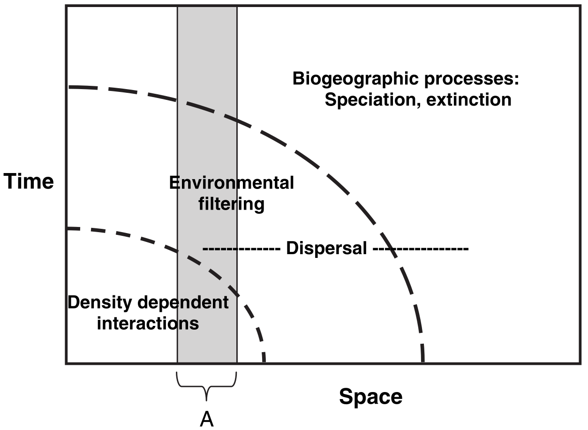
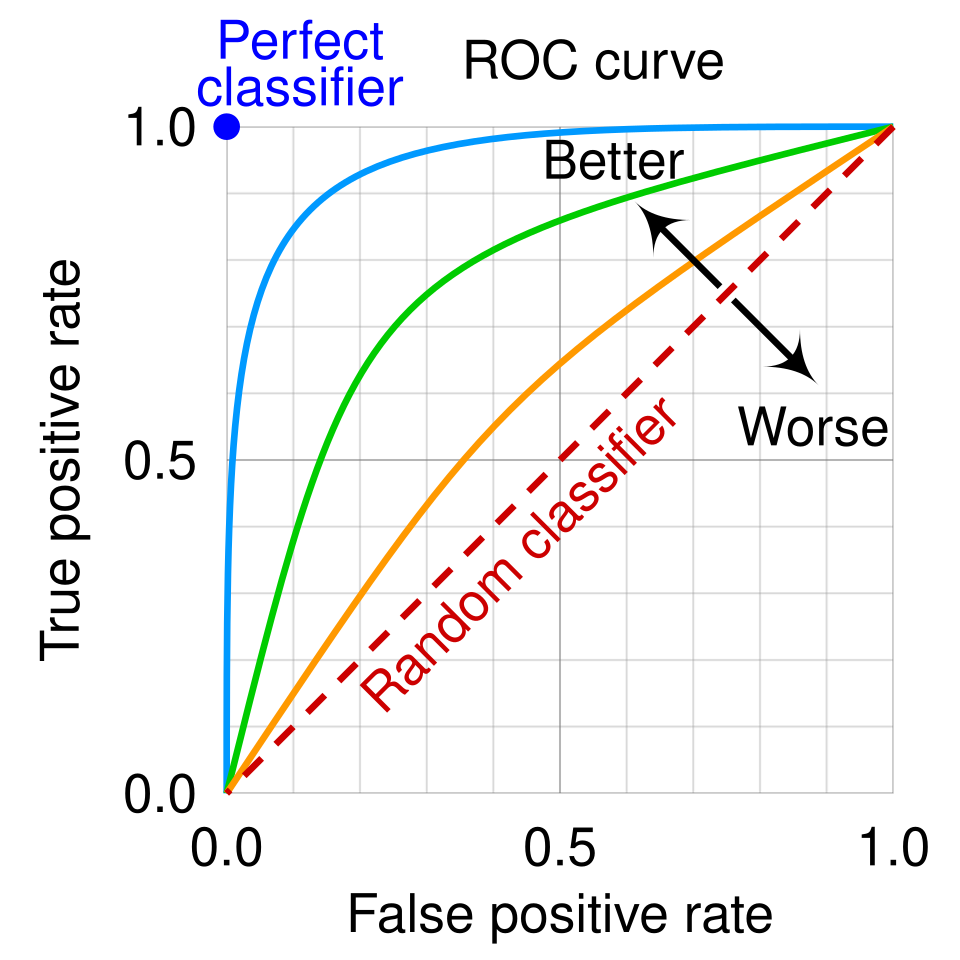
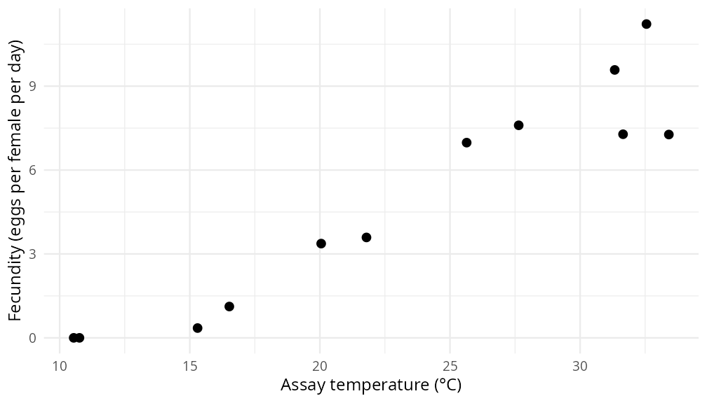
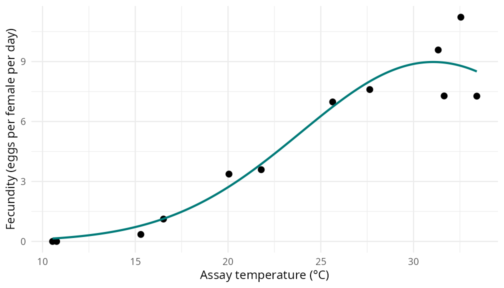
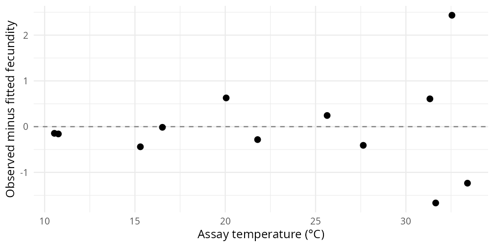

# (PART) November 2026 Training at Silwood Park {-}

# Introduction


## About the VBD Hub
The VBD Hub is a non-profit, open-source project funded by UKRI and Defra, with the overarching goal to **enhance links between data collection and analysis to support policy**. We work towards this goal in several ways:

1. **Data curation** – supporting the UK community to share data through global repositories according to FAIR standards and with appropriate access control. 
2. **Tools** – building infrastructure and packages to support data discovery, exploration and use. 
3. **Resources** –online/in-person training and networking to build a community of practice.


## About this event
The VBD Hub November training event will last 2.5 days, and consists of:

- An introduction to the Hub Search and ohvbd R package as tools to search and retrieve curated VBD datasets.
- Training in data curation for VBD databases.
- Pipelines for wrangling and visualising curated datasets.
- How to effectively communicate VBD research to different audiences. 
- Applied workshops to develop your analytical skills. 
- A challenge task to practise your skills.
- An opportunity to present your work to fellow participants.


**Analysis will be primarily in the R programming language**. This training is appropriate for participants who have working experience with R and beginner to intermediate statistical knowledge (e.g., ANOVA, hypothesis testing, linear regression).


## Schedule

<details>
<summary>Wednesday 11th November 2026</summary>

   09:10 - Pick up from Travelodge
   
   09:30 - Welcome, Pastries and Introduction

   10:00 - Hub Tools: What they are and how to use them

   11:00 - Coffee Break

   11:30 - Understanding Data Curation and Standards

   12:30 - Lunch

   13:30 - Wrangling VBD Data in R

   14:30 - Coffee Break

   15:00 - Visualising VBD Data in R

   16:00 - Break

   16:15 - Effectively Communicating with Different Audiences 

   17:15 - Training Day Ends

   17:30 - Dinner at Silwood
   
   18:30 - Return to Travelodge

</details>


<details>
<summary>Thursday 12th November 2026</summary>

   09:10 - Pick up from Travelodge
   
   09:30 - Welcome, Pastries and Introduction

   10:00 - Species Distribution Modelling

   11:00 - Coffee Break

   11:30 - Using Thermal Performance Curves in VBD Research

   12:30 - Lunch

   13:30 - Challenge Task

   15:00 - Coffee Break

   15:30 - Challenge Task (cont.)

   17:00 - Training Day Ends

   17:30 - Pub-Style Talk and Dinner at Silwood
   
   19:00 - Return to Travelodge

</details>


<details>
<summary>Friday 13th November 2026 (half-day)</summary>

   09:10 - Pick up from Travelodge
   
   09:30 - Welcome, Pastries and Introduction

   09:45 - Presentations

   11:00 - Coffee Break

   11:15 - Presentations (cont.)

   12:30 - Concluding Talk, Training Event Ends

</details>


## Meet the Team


**Chloe Coxshall** is a PDRA on the Hub at Imperial College London where she designs and delivers training events for the VBD community. She also conducts research using host traits to predict mosquito-borne disease transmission in UK bird and mammal species. When she is not working, you can find Chloe starting a new crafting project, or hanging upside down in an aerial hoop.

<div style="clear: both;"></div>


**Will Pearse** develops new statistical and computational tools to answer fundamental questions about the origins and future of biodiversity, and applies those insights to improve human wellbeing at Imperial College London. In this project, Will is focussed on how best to link environmental data with other types of biological data important for understanding VBD transmission.

<div style="clear: both;"></div>


**Samraat Pawar** studies how individual-level metabolism scales up through species (population) interactions to community- and ecosystem-level dynamics at Imperial College London. Samraat is supporting integration of existing repositories with the Hub and the development of software for working with the data.

<div style="clear: both;"></div>


**Francis Windram** is a PDRA on the Hub at Imperial College London where he develops tools and visualisations for disease vector trait and population data. During his PhD, he created computational imaging methods to extract traits from the webs of UK orb-weaving spiders. Aside from science, Francis is also an avid musician, climber, and nature enthusiast.

<div style="clear: both;"></div>


**Lauren Cator** researches the role of mosquito behaviour and ecology in disease transmission at Imperial College London. Lauren is leading the Hub and responsible for overall project management and coordination of the team and engagement with the wider UK VBD research community. 

<div style="clear: both;"></div>


**Sarah Kelly** is the data curator for the hub. She predominantly focuses on relationship building with data depositors and data wrangling. For the last 9 years Sarah has worked as part of the VEuPathDB funded by NIAID, curating both entomological and epidemiological data. When she isn’t curating data you will find her running, swimming and cycling around the coastline and camping on hilltops. 

<div style="clear: both;"></div>


**Stanley Modrak** is the software engineer behind the hub platform based at the Imperial College London. He has previously worked on risk analysis and compliance in cryptocurrency markets, digital bureaucracy and e-government platforms. 

<div style="clear: both;"></div>


# Pre-Work

We are excited to welcome you to the **One Health VBD Hub Training Event** on 11th-13th November at Silwood Park. 


Before the event, we would like you to complete this pre-work. This will help ensure everyone has a foundation understanding of the topics, and will be prepared to fully participate in the workshops. 


The pre-work covers three sections:

1. Navigating the VBD Hub
2. Understanding Data Curation Standards
3. Data Wrangling Principles 


**We ask that you complete these three sections, and ensure R, RStudio, and the relevant packages are installed on your device BEFORE the event.**


The packages you will need for the workshops are:

- `ohvbd`
- `tidyverse`
- `dplyr`
- `ggplot2`
- `rTPC`
- `nls.multstart`

For the thermal performance curves workshop, also run
`install.packages(c("rTPC", "nls.multstart"))` before the event. You can follow
the written course page in RStudio. The TPC lesson includes a downloadable
example and instructions for saving it in your project; using Git is optional.


We will be using the **VBD Hub Forum** for additional support before and during the training, as well as informal chats and coordination. Please have it set up in advance, and follow [this link](https://forum.vbdhub.org/t/november-training-silwood-park/253) to join. If you need help navigating the Forum, please see the video under [**2.1.1 The VBD Hub Forum**](#forumvideo).


You will need to bring your own laptop to participate in the event. Make sure it is updated, and remember to bring your charger. 


## Navigating the VBD Hub
The [VBD Hub website](https://vbdhub.org/) is home to resources to help your research, and spaces for collaboration and networking with the VBD community. The website is straightforward to navigate, but if you haven’t used it before, it can be helpful to understand what information is available and where to find it.


Watch this video tour of the VBD Hub website. Note: as the VBD Hub continues to grow, the website may have updated features in addition to those outlined in this video.


```{r, echo = FALSE}
knitr::include_url("https://www.youtube.com/embed/ctdCJemxRfU")
```


<details>
<summary>Video transcript</summary>

The VBD Hub website is home to resources to help your research, and spaces for collaboration and networking with the VBD community. The VBD Hub website is straightforward to navigate, but if you haven’t used it before, it can be helpful to understand what information is available and where to find it. In this video, we will walk through the main sections of the Hub and highlight some of the key tools and resources you can use.


When you first visit the site, you will see the Home screen. Here, you will find a general overview of what the Hub is and what it aims to achieve. You will also see the Getting started section, which provides quick access to some of the key information and resources available on the Hub site, including:

- Find data 
- Share data
- Learn


You may also notice the Roadmap section, which outlines the development of the VBD Hub over time, since July 2024. As the platform continues to grow, new developments will be updated here. 


The Find Data tab is one of the core features of the VBD Hub. This is where you can find the Hub Search tool, which allows you to explore open-access databases within the VBD Hub system. The search tool includes a filter panel, which can be used to refine your search based on different parameters, helping you find datasets relevant to your research. You may notice this page is linked under the Getting started section of the Home page.


Under the About tab, you will find a more in depth overview of the VBD Hub, including the aims of the Hub, and the critical impact of a platform like this. There is also a list of the Core team, and their involvement within the Hub. This section is useful if you want to better understand the background and overarching goals of the platform.


The Resources tab offers several useful pages which you can access through a dropdown menu:

- R package - This page provides information on the ohvbd package for R developed by the Hub, including latest release patch notes. 
- FAIR data - This section introduces FAIR data principles - making data Findable, Accessible, Interoperable, Reusable. These principles are important when working with open-access datasets. 
- How to share? - This page provides guidance on standards and privacy of data sharing, including standard operating procedures for specific data types. 
- Learn - Here, you can find learning resources developed by the Hub, including self-paced workbooks, and content from previous workshops. 


You may notice some of these are also linked under the Getting started section on the Home page. Overall, these resources support both data use and data sharing, as well as learning and training.


Under the Community tab, you will find another drop-down menu, with links to:

- Forum - This opens a separate page to the VBD Hub Forum, a space where users can connect with the VBD community by asking questions, sharing ideas, and discussing topics related to VBDs and data. 
- Blog - The blog includes updates and announcements from the Hub, including new developments, contributions, and upcoming opportunities, such as training sessions.
- Impact tracker - This page provides figures and statistics on how the Hub and its resources are being used by the community. By sharing these details, we demonstrate the value of data sharing and the broader impact of the Hub within the VBD community.


In this video we have covered how to navigate the VBD Hub website and where to find useful resources. Understanding the layout of the Hub will help you to make the most of the tools and datasets available in your own research.

</details>


During the training event, we will discuss some of the Hub tools and how to use them in more detail, including the Hub search and the ohvbd package.


::: {.rmdimportant}
**Task: Exploring the Hub**

Spend a few minutes navigating the VBD Hub website to familiarise yourself with the contents. 

Try to identify at least one feature you might use in your own work. 
:::


### VBD Hub Forum {#forumvideo}
The [VBD Hub Forum](https://forum.vbdhub.org/) is a space where users can ask questions, share knowledge and participate in discussions on VBD research and data. This resource provides users with an opportunity to connect with the VBD community.


Watch this video which walks you through how to use the VBD Hub Forum:


```{r, echo = FALSE}
knitr::include_url("https://www.youtube.com/embed/Px7cVLaidcw")
```


<details>
<summary>Video transcript</summary>

In the Navigating the VBD Hub video, we saw that the VBD Hub Forum can be accessed under the community tab on the Hub website. The VBD Hub Forum is a space where users can ask questions, share knowledge and participate in discussions on VBD research and data. This resource provides users with an opportunity to connect with the VBD community.


When you access the Forum, you will see that discussions are organised into categories and tags. For example, Training, General, Events, Jobs, and Infrastructure. Grouping similar discussion threads in this way makes it easier to navigate the Forum and find areas relevant to your interests. You can use the side bar, or the drop down menus to access a full list of categories and tags currently used on the Forum. You can select a category to explore the associated tags and discussion threads. For instance, if we click on General, we can use the “tags” button to view a list of tags used to group discussions under this category label. We can also scroll to see the existing discussion topics. 


The Forum is designed to be interactive, and there are several ways in which you can engage with this platform. You might want to:

- Follow discussions that are relevant to your work, so you can keep up to date with new developments and responses.
- Post a new question or start a discussion if you are looking for support or want to share a new idea.
- Respond to existing discussion threads by contributing your own knowledge, ideas, or experience.


For example, we can click on the “Welcome to VBD Hub Forum” discussion under the General category and scroll through existing responses. We can use the “like” button to like a response, and the “reply” button to post our own response. By contributing to discussions on the Forum, you are not only receiving support from the VBD community, but also helping to support others and to develop a collaborative network. 


In this video, we have covered how to navigate and use the VBD Hub Forum; a useful platform which supports collaboration and knowledge sharing within the VBD community.

<details>


By contributing to discussions on the Forum, you are not only receiving support from the VBD community, but also helping to support others and to develop a collaborative network. 


::: {.rmdimportant}
**Task: Register with the Hub Forum**

If you have not already done so, register an account with the VBD Hub Forum and follow [this link](https://forum.vbdhub.org/t/november-training-silwood-park/253) to join the thread for this training event. 

Once you have registered and joined the thread, introduce yourself or start a discussion.
:::


## Understanding Data Curation and Standards
Throughout the Training Event, we will be using Hub curated datasets to practice the skills learnt. Although users cannot upload data directly through the VBD Hub at this time, understanding this process is helpful for interpreting the datasets you retrieve using tools such as the Hub Search and the ohvbd package.


Watch this short video outlining standard operating procedures when curating VBD data.


```{r, echo = FALSE}
knitr::include_url("https://www.youtube.com/embed/8wcn_VpU2V8")
```


<details>
<summary>Video transcript</summary>

In this video, we will explore how data is shared, curated, and made available through the VBD Hub. Although users cannot upload data directly through the VBD Hub at this time, understanding this process is helpful for interpreting the datasets you retrieve using tools such as the Hub Search and the ohvbd package.


The VBD Hub resources bring together data from multiple sources, including databases such as VecDyn, VecTraits, and GBIF. Before being uploaded to these databases, datasets go through a process of curation, formatting, and standardisation to ensure the data is structured consistently. This consistency is what allows us to search across datasets, combine data from different sources, and use the VBD Hub data retrieval tools effectively. Understanding this process helps you to interpret the datasets you download, including:

- Why the datasets follow a particular structure
- How the variables are defined
- How data from different sources is combined in a consistent way


Before any dataset is shared, the VBD Hub follows a structured Data Management Plan, which outlines how data should be handled from collection through to publication. This process begins when a new dataset is identified, either by a researcher or through community contribution. 

1. The first step is to determine whether the data are sensitive, for example, whether they include identifiable human data. Sensitive datasets may require additional data protection measures or working with the Hub curator before submitting to an appropriate repository.
2. Next, the Hub assesses whether the data are ready for release. This includes checking whether the dataset meets publication requirements, or funder specifications. 
3. If the data are not yet ready for release, the Hub curator works with the data provider to prepare the dataset for release. 
4. If the data are ready for release the next step is to ensure ethical considerations are addressed, including data protection, and to apply appropriate metadata standards. 
5. Finally, the Hub determines whether the dataset should be hosted directly, or deposited into an external repository.


When sharing VBD data, it is important to consider the type of data being collected as different data types require different structures and standards. Data types might include:

- Occurrence data 
- Abundance data 
- Trait data 
- Genomic data 
- Proteomic data 
- Microarray data 
- Transcriptomic data 
- Epidemiological data 
- Environmental data 


Each of these data types follows specific standard operating procedures (or SOPs), which define how the data should be formatted and described. These SOPs help to ensure that datasets from different sources can be combined and compared within the database. 


Occurrence data record where and when a species has been observed. For this data type, the VBD Hub recommends using standards based on Darwin Core, which is widely used for biodiversity data. This means datasets should include:

- A confirmed species name using a recognised taxonomy
- Geographic coordinates
- A date of observation

Occurrence data are typically shared through platforms such as GBIF, which collate biodiversity records from around the world. Using Darwin Core ensures that your data can be integrated with these global systems and used in large-scale analyses of species distributions. Additional details, such as how the observation was made or who recorded it, are often included as metadata.


Abundance data describe how many individuals were collected at a given place and time. The VBD Hub formats these datasets for VecDyn, which focuses on vector population dynamics. To support this, datasets must clearly define:

- Sampling start and end dates
- Location identifiers
- Sampling method, such as trap type
- Sampling effort, such as number of traps 
- The units of abundance

These requirements ensure that abundance data can be interpreted clearly and used reliably with other datasets.


Trait data describe biological or ecological characteristics of a species. The VBD Hub recommends structuring these datasets for VecTraits, which is designed specifically for biological trait data. To ensure consistency, each record must include:

- A clearly defined trait 
- Standardised units of measurement
- The species the trait applies to
- Context such as life stage, sex, or environmental conditions

Standardising trait definitions allows researchers to compare characteristics across species and studies.


Genomic data describe DNA sequences and genetic information. The VBD Hub recommends depositing these data in established repositories such as GenBank, with links available through the Hub. These datasets must include:

- Sequence data in standard formats
- Metadata describing the organism, sampling location, and methods
- Links to associated publications or projects

Using established genomic repositories ensures long-term storage, accessibility, and integration with other molecular datasets.


Proteomic data describe the proteins expressed by an organism, helping us to understand biological function and response. These datasets are typically include:

- Protein identifiers or names
- Measurements of protein presence or abundance 
- Details of the experimental design 

The VBD Hub recommends uploading proteomic data to ProteomeXchange, and provides links to the appropriate data submission guidelines. 


Microarray data measure gene expression across many genes simultaneously. To be reusable, these datasets must include:

- Raw and processed expression data
- Clear descriptors of the experimental design 
- Information about the platform used

These datasets are often deposited in public gene expression repositories, ensuring they can be accessed and reanalysed by other researchers. 


Transcriptomic data describe RNA expression, showing which genes are active under specific conditions. The VBD Hub recommends submitting these datasets to repositories such as the Sequence Read Archive (SRA), with guidelines linked through the Hub. The requirements for these repositories include:

- RNA sequence data
- Expression measurements
- Experimental conditions and protocols

This information allows other researchers to interpret gene expression patterns and reuse the data in new analyses.


Epidemiological data describe disease occurrence and transmission in populations. These datasets often do not fit into a single external repository, so they may be hosted directly by the VBD Hub. They must clearly define:

- Case definitions
- Time and location of observations
- The population being studied

These data may involve sensitive information, therefore ethical considerations and data protection are especially important. 


Environmental data describe conditions such as climate, habitat, or land use. These datasets may be linked to external environmental databases or hosted within the Hub, depending on their structure. They must include:

- The variables measured, such as temperature or rainfall
- Units and measurement methods
- Spatial and temporal resolution

These details are essential for linking environmental data with biological or epidemiological datasets in later analyses. 


In this video, we have explored how data is shared, curated, and structured within the VBD Hub. Understanding these concepts provides important context for working with VBD data and helps you make better use of the resources available through the VBD Hub.

</details>


## Data Wrangling Principles
Data wrangling is the process of cleaning, transforming, and organising raw data into a format that is suitable for analysis. 


Throughout the Training Event, we will be using datasets retrieved from different sources. These sources might use inconsistent formats or unclear variable names, and therefore need to be wrangled before analysis.


**Understanding data wrangling principles will help you organise your data into a usable format, making further analysis smoother and more reliable.**


Before we start working with data in R, it is important to understand that data wrangling is not just a set of steps, but a process of making your data fit for your specific research question. 


The choices you make when cleaning and transforming your data will directly influence your results, so it is important to apply consistent and thoughtful approaches. 


Let’s have a look at some basic data wrangling techniques commonly applied to VBD datasets:


**1. Understand Your Data First**

**Do:** Explore your data before making any changes. We can look at the first few rows of our dataset using `head()`, which allows us to better understand our data, including checking the column names and data types. 


**Don’t:** Jump straight into cleaning the data without fully understanding how it is formatted. Without understanding the data, you risk misinterpreting variables and accidentally removing useful data.


**2. Save Your Raw Data**

**Do:** Keep an unchanged version of the raw dataset so you can access a previous version if something goes wrong, reproduce your work, and verify your results.


**Don’t:** Overwrite your original data. When wrangling your data in R, assign your cleaned data to a new object: `clean_data <- raw_data`.


**3. Use Clear & Consistent Naming**

**Do:** Use informative column, model, and object names so you know what your object is explicitly. Clear naming makes your R workflow easier for others (and yourself) to understand. You can rename columns using the `dplyr` function `rename()`:


``` r
clean_aedes_data <- clean_data |>
  rename(
    latitude = decimalLatitude,
    longitude = decimalLongitude
  )
```


In this function, the syntax works as: `new_name = old_name`.


**Don’t:** Use unclear names or names with messy formatting. Try to avoid spaces, special characters, or specific abbreviations.


**4. Reformat Your Data**

**Do:** Convert your data to long format for analysis, using the `tidyr` function `pivot_longer()`. 


``` r
clean_data <- clean_data |>
    pivot_longer(
      cols = starts_with("year"),
      names_to = "year",
      values_to = "abundance"
    )
```


We can break this down and have a look at what each part of this function is doing:

- `cols = starts_with("year")` - This selects the columns we want to reshape. In this case, we are selecting any column that starts with "year", (for example, `year_2010`, `year_2011`).
- `names_to = "year"` - This creates a new column called `year`, which will store the names of the original columns. Instead of having separate columns like `year_2010` and `year_2011`, those labels will now appear as values in a single column called `year`. 
- `values_to = "abundance"` - This creates a new column called `abundance`, which will store the data values that were previously spread across those year columns.


So instead of having one row with many year columns, we now have multiple rows where each row represents a single year-abundance observation. 


In this format, each row represents a single observation, which can make the data easier to filter and analyse.


**Don’t:** Use data in wide format, where values are spread across multiple columns. This can limit data wrangling and processing, such as grouping across different years and generating effective visualisations.


::: {.rmdtip}
**Tip: Dealing with NAs after pivoting**

When you convert data to long format, any empty cells in the wide data become rows with NA in the new values column. You can remove these rows by adding the argument `values_drop_na = TRUE` to your `pivot_longer()` code:


``` r
clean_aedes_data <- clean_aedes_data |>
    pivot_longer(
    cols = starts_with("year"),
    names_to = "year",
    values_to = "abundance",
    values_drop_na = TRUE
  )
```


Before using this argument, check what the NAs in your dataset actually mean:

- **The NAs come from the data’s wide format** - If the empty cells only exist because of how the data was spread across columns, for example, a site that was not sampled in a particular year, the rows hold no information and it is safe to remove them. 

- **The NAs are genuine missing data** - If a value should exist but was not recorded, for example, a site was sampled but the count was missing, keep these rows. Removing them hides gaps in your data, which may affect your analysis and results. 


Remember that **NA is not the same as zero**. A zero means no mosquitoes were found, but an NA means there is no information. Always look at your data after pivoting before deciding whether to remove NAs. 
:::


**5. Record What You Do**

**Do:** Keep track of your progress by recording what changes you made and why you used that approach. It is good practice to note these changes as comments in your code:


``` r 
# Rename columns for clarity
# Convert data to long format for easier analysis
```


**Don’t:** Rely on memory alone. It is easy to forget what analytical methods you used, why you chose that approach, and what order you processed your data in. Keeping clear records of your workflow contributes to better reproducibility. 


::: {.rmdcaution}
**Frequent Mistake:**

Try to avoid spaces, special characters, or specific abbreviations when naming objects in R.


There are a few options for alternative syntax, we would recommend:
- Using camelCase where letters are capitalised to indicate new words (e.g. `specificModelName`).
- Or using an underscore to connect words (e.g. `specific_model_name`).


If using camelCase, remember that R is case sensitive - if your object is named `specificModelName`, but you call `specificmodelname`, R will show an error:

`Error: object ‘specificmodelname’ not found`
:::


::: {.rmdimportant}
**Task: Applying Data Wrangling Principles to a Tick Dataset**

Open the dataset [ticktools_task.csv](https://github.com/One-Health-VBD-Hub/vbd-hub-training-workshops/blob/main/data/ticktools_task.csv) in RStudio. This is a VecDyn dataset containing counts of ticks collected at sites across England as part of the TickTools project, and is available through the VBD Hub. We have made some changes to the original dataset to give you the opportunity to practise these data wrangling skills. 


Work through the following points:

1. Inspect the dataset using `head()`. Notice what the columns represent, what the data types are, and whether there are any missing values.

2. Rename your data as a new object. Any changes you make will use this new object, rather than the raw data.

3. Rename at least two columns using `rename()`. 

4. Check whether your dataset is in wide or long format. Use `pivot_longer()` if required.

5. After pivoting, look at your data again and check for NAs. Think about what these values represent, and decide whether they should be removed.

6.  Add comments to your code explaining what changes you made and why.


The original VecDyn dataset, [ticktools_original.csv](https://github.com/One-Health-VBD-Hub/vbd-hub-training-workshops/blob/main/data/ticktools_original.csv), is already in long format, with clear and consistent column names. Each abundance count is stored in a single column, `sample_value`, rather than being spread across separate year columns. This is one of the benefits of using data from a curated repository - the data has already been standardised. 


The original dataset also has many more columns than the task version, including information on taxonomy, sampling methods, and who collected the data. Some of these additional columns are empty, as not every study records every type of information. We will look at these columns in more detail during the Training Event.
:::


You will now be familiar with some core data wrangling principles, which will prepare you for the Wrangling VBD Data workshop during the Training Event. In this workshop, we will cover a handful of essential wrangling techniques for VBD data.


# Hub Tools: What They Are and How to Use Them

## Overview
The VBD Hub brings together datasets, tools, and community resources to support vector-borne disease research. In the pre-work, you learnt how to navigate the Hub and where to find its useful resources. This session builds on that by focusing on two tools for searching and retrieving data, Hub Search, the Hub’s web-based search interface, and ohvbd, an R package that allows you to search for and retrieve data directly in R. During this workshop, you will practice using both, learn how to refine your searches, and check what they return, and compare the two tools so you can choose the one that best fits your workflow. 


### **Learning Objectives**

By the end of this workshop, you should be able to:

1. Use Hub Search filters to search and download datasets relevant to a specific research question.
2. Build an ohvbd pipeline in R to search for, filter, and fetch VBD data.
3. Refine ohvbd searches using smart search functions.
4. Inspect retrieved data to check it matches your research questions and identify whether wrangling is required. 
5. Understand the differences between the Hub Search and ohvbd package, and choose the right tool for your workflow. 


## Searching and Retrieving Data with Hub Search
As we have seen, the **Hub Search** can be found under the **Find Data** tab on the **VBD Hub** website. 


The **Hub Search** makes discovering datasets much easier by allowing you to search across multiple data sources in one place. This means you can identify datasets relevant to your research and explore the associated metadata before downloading, rather than searching each database source individually.


On the **Find Data** page, you will see a **Filter** panel with several options that let you refine your search. These include:

- **Category** - Filter your search based on data type, such as Occurrence, Abundance, Traits, Proteomics, and Epidemiological data. 
- **Database** - Filter by source database, including VecDyn, VecTraits, GBIF, ProteomeXchange, and the VBD Hub.
- **Published** - Set a date range for when the data was published by entering a start and end date. 
- **Location** - Define a geographic area by drawing a polygon on the map. 
- **Taxonomy** - Search for a specific species or taxonomic group.
- **Full text search** - Refine your search by using specific keywords. 


These filters help you to narrow down your search results and find datasets that are the most relevant to your research.


::: {.rmdtip}
**Note:** The Hub Search tool retrieves data from several open-access databases. If you are unfamiliar with these databases, they include:

- **VecDyn** - Data on vector population dynamics, including how vector populations change over time and across locations. 
- **VecTraits** - Data on vector traits, such as life history, behaviour, and ecology. 
- **GBIF** - Species occurrence records, showing the time and location vector species have been observed.
- **ProteomeXchange** - Proteomic and molecular vector data. 
::: 


Once you have run a search, the results will be displayed on the same page. These typically include the dataset name, the source database, and a brief description of the dataset. 


You can also access further details, including the metadata, and geographic or temporal coverage. Clicking on the dataset will let you see options to access or download the dataset.


These details can help you decide whether the dataset is suitable for your research before downloading it. 


After reviewing your results, you might decide to refine your search. You might consider:

- **Relevance** - does the dataset answer your research question?
- **Coverage** - does the dataset include the correct location or time period for your research?
- **Structure** - is the data in a usable format?


You can refine your search by adding more filters, using more specific keywords, or combining terms, such as “species name + location”.


::: {.rmdtip}
**Tip:** Start with a broad search, and then gradually narrow it down.


Remember, you don’t have to download everything - you should focus on datasets that are the most useful for your research and analysis.
:::


::: {.rmdimportant}
**Task: Retrieving Ixodes ricinus Data Using Hub Search**

Use the Hub Search and relevant filters to find datasets on abundance of *Ixodes ricinus*. How many results did your search return?


Select one dataset from your search and identify the:

- Dataset name
- Publication date
- Source database
:::


## Searching and Retrieving Data with the ohvbd R Package
**ohvbd** is an R package developed by the VBD Hub that allows you to search for and retrieve data within R, without needing to download files manually from multiple sources.


It connects to several VBD databases at once, including:

- **VecTraits (vt)**
- **VecDyn (vd)**
- **GBIF (gbif)**
- **ProteomeXchange (px)**
- **AREAdata**, which is accessed with separate functions, such as `fetch_ad()`


This means you can pull datasets directly into your R workflow, making data retrieval much more efficient.


### Building a Search Pipeline with ohvbd
To get started, we need to install and load the ohvbd package in R: 


```{r, eval=FALSE}
install.packages("ohvbd")

library(ohvbd)
```


Once installed, we can start searching for data. 


The ohvbd package uses a piped workflow, which allows us to build our search step-by-step.


If we wanted to search for data on *Ixodes ricinus* from the **VecTraits** database, we can run:


``` {r, eval=FALSE}
ixodes_ricinus_data <- search_hub("Ixodes ricinus") |>
  filter_db("vt") |>
  fetch() |>
  glean()
```


Let’s break this down a bit so we can understand what each step is doing:

- `search_hub()` - Searches for datasets matching your query, here we want to search for `"Ixodes ricinus"`. This gives us the IDs of matching datasets, not the data itself.
- `filter_db()` - Narrows results to a specific database, in this case `"vt"`, for VecTraits.
- `fetch()` - Downloads the data for those IDs, in its raw format.
- `glean()` - Converts the raw data into a usable dataframe.


::: {.rmdtip}
**Tip:** We can consider a basic search with ohvbd as 4 stages:

1. **Find** the data.
2. **Filter** the search.
3. **Fetch** the data.
4. **Format** the data.
:::


The data retrieved using **ohvbd** is often raw, and its structure depends on how the original source database is formatted. This means that after retrieving the data, you will usually need to wrangle the data before you start any analysis. 


### Quick Searches with ohvbd
If you know which database you want to use, you can make your search more efficient by specifying the details directly into `search_hub`:


``` {r, eval=FALSE}
search_hub("ixodes ricinus", db = "vt")
```


This gives the same result as `filter_db()`, but is more efficient because it only searches the database you need.


::: {.rmdtip}
**Tip:** You can write `?search_hub` or `?fetch_vt` in the R console to access guide documents if you need extra help using ohvbd.
:::


### Refining an ohvbd Search
We can make our search more refined by adding more parameters to `search_hub()`:


``` r
search_hub(
  query = "",
  db = c("vt", "vd", "gbif", "px"),
  fromdate = NULL,
  todate = NULL,
  locationpoly = NULL,
  taxonomy = NULL,
  exact = FALSE,
  withoutpublished = TRUE,
  returnlist = FALSE
)
```


Let’s have a look at what each of these arguments does: 

- `query` - What you are searching for, such as a species name.
- `db` - Which databases we want to search
- `fromdate` and `todate` - Filter by a specified date range. These parameters use ISO format (yyyy-mm-dd). 
- `locationpoly` - Define a geographic search area.
- `taxonomy` - Search by species ID. 
- `exact` - Return exact matches only.
- `withoutpublished` - Include results without publication dates.
- `returnlist` - Return the raw output list of datasets, rather than a formatted dataframe.


::: {.rmdtip}
**Tip:** 

You do not need to use all of these arguments at once. Start simple and build a search pipeline that aligns with your search aims.
:::


::: {.rmdcaution}
**Frequent mistake:** 

`taxonomy` and `locationpoly` need inputs in a specific format, which `ohvbd` can create for you:

- `match_species()` finds species IDs from GBIF, using the `rgbif` package. For example, `match_species("Culex pipiens")`.
- `match_countries()` creates a country outline, using the `rnaturalearth` package. For example, `match_countries("United Kingdom")`.


You can find out more on the [match_species()](https://ohvbd.vbdhub.org/reference/match_species.html) and [match_countries()](https://ohvbd.vbdhub.org/reference/match_countries.html) reference pages.
:::


::: {.rmdnote}
**Example: Retrieving *Culex pipiens* Data Using ohvbd**

Imagine we want to retrieve population data on *Culex pipiens* from **VecDyn**. 


We can start by defining our search query and filter by database using `search_hub()`:


``` {r, eval=FALSE}
search_hub(
query = "Culex pipiens", 
db = "vd")
```


We can also make our search more specific by adding a date filter directly into our search. For example, we might only want datasets published from 2010 onwards:


``` {r, eval=FALSE}
search_hub(
query = "Culex pipiens", 
db = "vd", 
fromdate = "2010-01-01")
```


Note that this filters by when the dataset was published, not when the data were collected.


We can also add:

- `exact = TRUE` so our search only retrieves exact matches, 
- `withoutpublished = FALSE` so datasets without publication dates aren’t retrieved.

``` {r, eval=FALSE}
search_results <- search_hub(
query = "Culex pipiens", 
db = "vd", 
fromdate = "2010-01-01",
exact = TRUE,
withoutpublished = FALSE)
```


This search returns the IDs of the datasets that match our search criteria. We have stored these in an object called `search_results`, which contains information about each dataset, rather than the data itself. This allows us to review the results before retrieving the full datasets. We can view them by running `search_results` in the R console.


Once we are happy with the results, we can retrieve the data with `fetch()`, and use `glean()` to extract it and convert it into a usable dataframe:


``` {r, eval=FALSE}
culex_pipiens_data <- search_results |>
 fetch() |>
 glean()
```


Now we have retrieved the data, we can have a quick look by running:


``` {r, eval=FALSE}
head(culex_pipiens_data)
```


We can save the dataset for future use using `write.csv()`:

`write.csv(culex_pipiens_data, "culex_pipiens_data.csv", row.names = FALSE)`
:::


::: {.rmdtip}
**Tip:** 

Broad searches can return a lot of datasets, which can take a while to download. Run `length(search_results)` to see how many datasets your search found, and use `head()` to try fetching just a few first, for example:


``` {r, eval=FALSE}
culex_pipiens_data <- search_results |> 
  head(5) |> 
  fetch() |> 
  glean()
```
:::


### Unexpected Search Results
As you become more familiar with the ohvbd package, you might find that your searches do not always return exactly what you expect. 


This is because searches are not only based on exact matches, but also on how datasets are indexed and described within the underlying databases. 


For example, a search term may match multiple fields within the dataset:

- Species names
- Dataset titles
- Metadata descriptions


This means that a search can return results that are related to your query, but not exactly what you intended. 


::: {.rmdnote}
**Example: Unexpected Results from a *Bemisia* Search**

Let’s have a look at an example of a search that returns unexpected results.


Imagine we are searching for trait data on *Bemisia*, a genus of whitefly, using the **VecTraits** database:


``` {r, eval=FALSE}
df <- search_hub("Bemisia", db = "vt") |>
  fetch() |>
  glean()

head(df)
```


At first glance, everything may look fine. However, if we explore the dataset further, for example, by checking the unique values in the genus column, we might notice something unexpected:


``` {r, eval=FALSE}
unique(df$Interactor1Genus)
```


Alongside *Bemisia*, another genus appears: *Axinoscymnus*, which is a ladybird. This can seem confusing, we searched for whiteflies, not ladybirds. 


If we look more closely at the dataset, we can see that:

- *Axinoscymnus* appears in the `Interactor1Genus` column
- *Bemisia* appears in the `Interactor2Genus` column


This tells us that the dataset includes interactions between species. So while *Bemisia* is included in the search results, it is not always the primary species the trait data refers to.
:::


To mitigate unexpected results, the ohvbd package provides more advanced ways to refine your search. 


One key approach is to use **smart search functions**, written as `search_x_smart()`, where `x` can be replaced with the code for the appropriate database, such as `vt` for VecTraits, or `vd` for VecDyn. 


Unlike `search_hub()`, which searches across multiple fields, smart search functions let you choose which field to search, how to match it (e.g. `"equals"` or `"contains"`), and the value to look for. This means you can control exactly where your search term is being matched.


::: {.rmdnote}
**Example: Unexpected Results from a *Bemisia* Search (cont.)**

Instead of searching broadly for *Bemisia*, we can refine our search using a smart search function.


Our previous code (see previous Example) returned datasets where *Bemisia* appeared in multiple columns, including as a secondary interacting species. 


To make the search more specific, we can use `search_vt_smart()` to target the column that represents the primary species the traits refer to:


``` {r, eval=FALSE}
df_smart <- search_vt_smart("Interactor1Genus", "equals", "Bemisia") |>
  fetch() |>
  glean(
    cols = c("Interactor1Genus", "Interactor1Species", "Interactor2Genus"),
    returnunique = TRUE
  )

unique(df_smart$Interactor1Genus)
```


Here we have also used `cols` in `glean()` to keep only the columns we need, and `returnunique = TRUE` to remove any duplicate rows.


We can see that only *Bemisia* appears in the primary species column. This mitigates the unintended results, such as *Axinoscymnus*, that appeared in our earlier search.
:::


By using smart search functions, we can more precisely control how our query is applied, ensuring that the data we retrieve aligns with our research question. 


In addition to refining the search itself, it is often necessary to apply data wrangling techniques after retrieval. 


These might include:

- Filtering rows based on specific conditions
- Standardising or correcting species names
- Merging columns where necessary


These steps are a normal part of working with integrated datasets, where multiple species, interactions, or naming conventions may be present.


By combining targeted searching with careful data wrangling, we can ensure that the final dataset aligns with our specific research question.


## Hub Search vs. ohvbd
You might have noticed that the **ohvbd package** and the **Hub Search** are quite similar, as they both allow you to search across multiple databases.


However, there are some differences between the two resources:

- With ohvbd, once your code is written, it can be re-run to retrieve updated data, which improves reproducibility. 
- Additionally, all results can be retrieved and combined directly within R. 
- With Hub Search, datasets are typically downloaded manually one at a time.
- ohvbd is most useful for users who work in R, whereas users who work with other software will find the Hub Search more appropriate.


Both tools are useful, and the best choice depends on your workflow and experience.


::: {.rmdimportant}
**Task: Retrieving the Same Dataset with Hub Search and ohvbd**

Have a go at retrieving the data from this paper using both the Hub Search and ohvbd: Blagrove MSC, Arias-Goeta C, Di Genua C, Failloux A-B, Sinkins SP (2013). A *Wolbachia w*Mel transinfection in *Aedes albopictus* is not detrimental to host fitness and inhibits Chikungunya virus. *PLoS Neglected Tropical Diseases* 7(3): e2152.


Remember to think about which filters will narrow your search most efficiently.


For Hub Search, open the dataset, check its metadata, and download it. 
For ohvbd, use `fetch()` and `glean()` to retrieve the dataset as a dataframe. 


Once you have retrieved your dataset, consider:

- Which filters did you use, were these the most efficient?
- Which tool got you to the dataset faster?
- Which tool would you use if you needed this dataset plus several similar ones?
:::


## Key Takeaways

- The Hub Search and ohvbd both let you search several VBD databases at once, so you don’t need to search each source individually. 
- Start with a broad search and then narrow down, checking results for relevance, coverage and structure before downloading. 
- Searches match across species names, dataset titles and metadata, so results may include data you didn’t expect. Smart search functions with ohvbd let you target a specific column. 
- Choose the tool that best fits your workflow. Hub Search suits point-and-click exploration and non-R users. ohvbd is better suited to R users, anyone working with multiple datasets, and anyone who needs a reproducible search they can re-run. 


# Understanding Data Curation and Standards

## Overview

So far, we have learnt how to search for and retrieve data using VBD Hub resources. In this session, we will look at the other side of that process and consider how datasets are curated and standardised before they reach the Hub. We will discuss publishing decision frameworks to help decide where and how a dataset is shared, how FAIR data principles guide the whole process, and you will have the opportunity to prepare a dataset for VecDyn yourself. Understanding data curation and standards will help to interpret the datasets you retrieve from existing databases, and prepare your own data for sharing. 


### **Learning Objectives**

By the end of this workshop, you should be able to:

1. Prepare a dataset for VecDyn using the VecDyn column definitions. 
2. Apply the FAIR data principles to assess and improve a dataset.
3. Explain how curation and standards shape the data you retrieve with Hub Search and ohvbd. 
4. Appropriately cite datasets, repositories and resources.


## Identifying Data Types

In the pre-work, you were introduced to the different types of data the VBD Hub works with, and the standard operating procedures (SOPs) used to curate each type. Identifying the data type is the first step in curation, because it determines where a dataset is stored and how it should be formatted. Let’s start with a quick recap. 


::: {.rmdimportant}
**Task: Identifying Data Types**

For each example, decide which type of data it is:

1. Weekly counts of *Culex pipiens* caught in light traps at five sites over two years. 
2. A record of *Aedes albopictus* observed in a garden in Kent in August 2023. 
3. Larval development time of *Anopheles gambiae* at five different temperatures. 
4. Monthly reported human West Nile virus cases by region. 
5. Mass spectrometry analysis of proteins in mosquito salivary glands. 
6. Blood-meal analysis showing which host species *Culex pipiens* fed on.
7. Museum specimen records of *Ixodes ricinus* with collection dates and locations.
:::


## Publishing Decision Framework

To ensure datasets are shared in the most appropriate way, the VBD Hub uses a publishing decision framework. 


This framework guides three key decisions:

- What type of data is being shared
- Which database it should be stored in
- How it should be formatted


Once you have identified the data type, you can map this to the recommended repository:

- **Omics data** are typically stored in genomic and proteomic repositories such as **GenBank** or **ProteomeXchange**.
- **Abundance data** are directed to **VecDyn**.
- **Trait data** are stored in **VecTraits**.
- **Occurrence data** are shared through platforms like **GBIF**.
- **Epidemiological or mixed datasets** may be hosted directly by the **VBD Hub**.


This ensures that each dataset is stored in a system best suited to its structure and use.


::: {.rmdnote}
**Example: Preparing a Dataset for VecDyn**

Imagine we have collected mosquito abundance data weekly using light traps at several sampling locations. 


Our raw dataset might look something like this:

- A column called `Date` with mixed formats
- A column called `site` with inconsistent naming
- A column called `Count` with no explanation of how counts were collected.  


We then want to prepare this dataset for **VecDyn**. 


Instead of choosing column names ourselves, we use the [VecDyn column definitions](https://vectorbyte.crc.nd.edu/vecdyn-columndefs) resource. This provides a standardised list of column names, along with clear definitions of what each column name means and how it should be used. 


For example: 

- If we have a column describing when the sampling took place, the table specifies the column names `sample_start_date` and `sample_end_date`.
- If we want to record each sampling location, we would use `sample_location`.
- If we are recording the species, we can use standard taxonomy in `species` and `genus` columns. 
- Our abundance dataset contains count data, which we would record in a column called `sample_value`.
:::


The VecDyn definitions table is accompanied by additional information that guides how the data should be structured:

- **Notes** - provides further explanation, helping to clarify how the column should be used and what the values represent.
- **Is Required** - indicates whether a column must be included in the dataset to be accepted and usable within the VecDyn database. 
- **Data Format** - specifies how data values should be recorded. For example, dates must follow a consistent ISO format.
- **Restrictions** - provides rules about what values are allowed. This might include controlled vocabularies or limits on acceptable entries. 


Given these details, we would also want to check how our data is formatted, for example, our start and end date must be in ISO format. We would also need to add any required details, such as a `sampling_method` column to state the trap type.


By following these definitions, we are not just organising our dataset, we are aligning it with a shared formatting standard. This is what allows tools like the VBD Hub Search and the ohvbd package to work with multiple datasets in a consistent way - they can rely on the same column names, formats, and definitions across all data.


## FAIR Data Principles

An important concept guiding this entire data sharing process is the use of **FAIR data principles**.


**FAIR stands for Findable, Accessible, Interoperable, Reusable:**

- **Findable** - datasets are assigned metadata and identifiers so they can be discovered through search tools.
- **Accessible** - data can be retrieved using standard protocols, with clear information about access conditions. 
- **Interoperable** - datasets use standard formats, vocabularies, and structures so they can be integrated with other data.
- **Reusable** - datasets include sufficient documentation, metadata, and licensing so they can be used in future research. 


The **VBD Hub** supports these principles by ensuring datasets are well-documented, consistently structured, and linked to appropriate repositories, so that these datasets can be discovered, accessed and reused openly and effectively. 


::: {.rmdimportant}
**Task: Preparing a Dataset for VecDyn**

You’ve been given the following [raw data](https://github.com/One-Health-VBD-Hub/vbd-hub-training-workshops/blob/main/data/vecdyn_prep_task_raw.csv) and short Methods paragraph. Working in small groups, use the [VecDyn column definitions](https://vectorbyte.crc.nd.edu/vecdyn-columndefs) resource to prepare this dataset for upload to VecDyn.


Here are some prompts to help you:

- Which VecDyn column should each existing column map to?
- What needs to change in the values themselves?
- How might you work out the start and end dates where these are missing?
- What required information is missing?
- How does the metadata from this dataset support each of the FAIR principles?


**Methods**

Adult mosquitoes were collected using Mosquito Magnet, BG-Pro and BG-Sentinel 2 traps, and larvae and pupae were collected by dipping. Surveillance ran from 1st June to 31st October 2024. Catches were pooled and reported by sampling week. For each record, the Date is the first day of a 7-day sampling week, and the count is the number of *Culex modestus* caught at that site during that week. At some sites, *Culex modestus* was not found at any point during the survey. For these sites, there is a single record with a count of 0. This record covers the whole survey period, and its Date is the first day of the survey. All specimens were identified morphologically. 


(This dataset and Methods has been edited for this task. The original dataset is from Abbott *et al*. (2025) “Evidence of much wider distribution of the potential West Nile virus vector, *Culex modestus*, in the UK”, *Parasites & Vectors* 18: 482, [doi:10.1186/s13071-025-06936-3](https://link.springer.com/article/10.1186/s13071-025-06936-3).
:::


## Why Use Curated Data and Standards?

Understanding how data is curated and structured also helps when using tools like the **Hub Search** or the **ohvbd** package. 


For example, when you retrieve data, you may notice:

- Standardised column names
- Consistent date formats
- Structured metadata


These features are a direct result of the data curation process.


Recognising this can help you interpret datasets more effectively and identify any limitations or inconsistencies. For example, you might notice multiple columns for species names based on different databases, which you can mitigate by merging.


These standards aren’t only useful when using other people’s data. Applying them to your own data from the start brings the same benefits:

- Your datasets are structured the same way across projects, field seasons, and team members.
- Your data can be easily combined with other datasets without extensive formatting. 
- Recording data in a standard format from the outset means you spend less time cleaning and wrangling later on. 
- Improves the reproducibility of your work, especially for publications.
- If your data already follows **VecDyn** or **VecTraits** standards, it is ready to submit when you publish, so your work can be found, reused and cited by others.


## From the Data Curator
Sarah is the VBD Hub Data Curator. Her job involves finding the data we all want to see, taking a deep dive into the ongoings of the data, reshaping it into something that can be reused over and over again and building relationships within the community to create trust in the Hub, trust to share their data in a way that gives them full control and let's the world see their research. 


We've asked Sarah some questions about the data curation process and submitting data to the VBD Hub.


**What are the most common problems you see in datasets submitted to the Hub?**

"1. **Missing data** - When planning your experiment, right at the start, think about what variables you need to use to make this reusable. So we often have:

- Missing dates
- Missing species identification methods
- Missing locations
- Missing trap types
- Missing information on how long the traps are left out for


2. **Poor data dictionaries** - When a curator asks the provider what the data means and they too are confused. This is often caused by instructions lost in communication between team members, all recording things in slightly different ways.
 
 
3. **Problems with zeroes** - What does your 0 mean? Does it mean a trap failed, does it mean a trap was put out and none of that mosquito species were collected, why were those mosquito species put in your dataset anyway?


4. **Dates** - They can be differently interpreted from where you are in the world so let’s please use YYYY-MM-DD.


5. **Data in wide format** (not long format) - which requires more wrangling!"


**What’s one thing researchers could do at the data collection stage that would make curation much easier?**

"1. Think about **reusability**, think about if you wanted to use your data in the future for a different analysis. Have you collected enough information and in an understandable way that you could pick it up in 3 years time and know what it all means?


2. **Standardise** your data collection sheets! Give all your team the same data collection templates.


3. Look at a data repository you want to deposit in and check you have all the **required fields** before you start collecting data."


**What happens to a dataset after it’s submitted?**

"This depends on what data you submit to the Hub. In general what will happen is that I will run checks on the data to check all the required fields for that data type are in the dataset. I will check if I have data dictionaries/methods/publications that will help me to understand the data and then I will reshape the data into the format required for submission to the individual repositories. Anything that is unclear or if I notice data duplications or missing location info etc I will contact the provider. The more info you provide, the less I have to bother you!"


**How should people get in touch if they want to share their data?**

"There are a few ways to get hold of the Hub team but if you want to go direct to source, please email me at s.kelly@imperial.ac.uk. I don’t bite, I don’t mind how messy your data is, trust me I have seen it all and that is what I am here for! To help you future proof your own work. To take away some of that burden. 


I think it is actually always really helpful to reach out to me at the very beginning of your study! I can help check you are collecting all the right data to make your data FAIR. Having your data in a place for all to see leads to some awesome future collaboration opportunities when someone discovers your data and wants to reach out to you! So, we require you to share your contact information with us on the dataset so you can be reached directly."


## Citing Curated Datasets

When using datasets from the **VBD Hub**, it is important to consider data provenance and attribution. You should:

- Check the dataset metadata for authorship and source.
- Identify the original database.
- Follow licensing and usage conditions.
- Cite both the dataset and the source repository. 


Proper citation:

- Gives credit to data contributors
- Supports reproducibility
- Ensures transparency in your research


::: {.rmdtip}
**Tip:** Remember to cite the tools you use to retrieve data as well. If you used **ohvbd**, run `citation("ohvbd")` in R to get the recommended citation.
:::


## Key Takeaways

- Identifying the data type is the first step in curation, because it determines where a dataset is stored and how it is formatted.
- Standard column definitions, formats and vocabularies allow datasets from different sources to be combined, which is what makes tools like the Hub Search and ohvbd possible. 
- The FAIR data principles guide curation so that data can be found, accessed, integrated and reused. 
- Applying data curation standards to your own data from the start saves time later and makes your data easier to share, reuse and cite.
- Always cite the datasets, repositories and tools you use. 


# Wrangling VBD Data in R

## Overview

Data retrieved through the **VBD Hub**, using tools such as the **Hub Search** or the **ohvbd** package, can be raw and may include missing values, inconsistent formats, or unclear variable names. 


**Data wrangling is the process of cleaning, transforming, and organising this data into a format that is suitable for analysis.**


In this session, we will introduce key data wrangling principles, and explore commonly used techniques in VBD research, including merging datasets and standardising species names.


### **Learning Objectives**

By the end of this workshop, you should be able to:

1. Clean and transform VBD Hub datasets ready for analysis. 
2. Handle common data issues, such as inconsistent formats, duplicates, and missing values.
3. Reshape and merge datasets using standardised structures and identifiers.
4. Standardise species names using recognised taxonomic conventions. 


## Shifting Perspectives: Problems to Decisions 

Real-world VBD data is rarely clean, especially if it has been collected for different purposes or recorded using different reporting standards. You may encounter:

- Missing values
- Inconsistent data types
- Poorly named columns
- Duplicate records
- Data stored in inconvenient formats


Rather than treating these as isolated problems, it can be helpful to recognise common patterns which affect downstream analyses. For instance:

- Inconsistent naming affects merging datasets
- Mixed data types affect calculations
- Wide format affects analysis and visualisations


When we think about data inconsistency patterns in this way, we shift our focus from **problems** to **decisions**. Each issue you identify in your dataset requires a decision:

- Should missing values be removed or retained?
- Should columns be renamed or merged?
- Should data be formatted from wide to long format?


When we stop asking **"what is wrong with this dataset?"** and start thinking **"what do I need this dataset to do?"**, we can make informed decisions and prioritise the most appropriate data wrangling approaches to your data and research question. 


We cannot cover every data wrangling principle within a single training session. Today, we will focus on two commonly used data wrangling techniques applied to VBD datasets:

- Merging datasets
- Standardising species names


## Merging Datasets

In many research workflows, we use more than one dataset. It is rare for a single dataset to contain all the information needed to answer a research question. 


For instance, you might have:

- One dataset containing species abundance data 
- Another dataset containing environmental variables. 


If you want to analyse how environmental factors influence species abundance, you will need to combine these into a single dataset.


We call this **merging** or **joining** datasets. 


For a merge to work effectively, both datasets must share at least one common column name. This shared column is known as a **key**. In VBD datasets, a common key might be a species name, a location, or a date. 


Let’s imagine we have two datasets which both contain a column called `species`.


We can merge these two datasets using the `left_join()` function from the `dplyr` package:


``` {r, eval=FALSE}
library(dplyr)

merged_data <- left_join(dataset_a, dataset_b, by = "species")
```


In this code:

- `dataset_a` is the main dataset we want to keep.
- `dataset_b` contains data we want to add.
- `by = "species"` tells R to match rows using the `species` column.


A left join keeps all the rows from `dataset_a` and adds matching information from `dataset_b` where the species value is the same.


### Different Merge Types

There are different types of merges or joins, each of which acts slightly differently:

- A **left join**, `left_join()`, keeps all the rows from the first dataset and adds matching values from the second. This is usually the safest option, as it avoids losing data. 
- An **inner join**, `inner_join()`, only keeps the rows that appear in both datasets. This is useful when you only want complete matches, but it risks accidental data loss.
- A **full join**, `full_join()`, keeps all the rows from both datasets. Missing values are filled with `NA` where matches do not exist. This can be helpful in exploratory work, but may require further data cleaning.


Choosing which merge to use depends on your research question and how you want to format rows that don’t align across datasets. If in doubt, we recommend using a **left join**.


### Merging with Multiple Keys

Sometimes, a single column is not enough to uniquely identify matches.  For instance, in VBD research the same species might appear in multiple locations. In this case, we can merge using multiple keys.


``` {r, eval=FALSE}
merged_data <- left_join(dataset_a, dataset_b, by = c("species", "location")
```


Here, the vector `c("species", "location")` tells R to match rows where both the `species` and `location` are the same. 

Setting multiple key columns ensures more accurate matching, especially when working with ecological or epidemiological data, where the species might appear in multiple regions and should be accounted for with this in mind.


### Frequent Merging Mistakes

Merging is usually straightforward, but it can sometimes produce unexpected results. 


One common cause of unexpected merge results is inconsistent formatting between datasets. For instance, if `dataset_a` formats species names as `"Ixodes ricinus"` and `dataset_b` formats species names as `"ixodes_ricinus"`, R will not identify these species as a match for merging.


This can result in missing values or incomplete merges. 


It is useful to remember that **a successful merge does not always mean a correct merge**. Even if your code runs without errors, the output might not be what you were aiming for.


This is why it is important to check the merge results:

- Has the number of rows changed significantly?
- Are there unexpected missing values?
- Do the matches look correct?


A simple check is to compare the number of rows before and after merging using `nrow()`:

``` {r, eval=FALSE}
nrow(dataset_a)
nrow(merged_data)
```


This will check the number of rows in the original dataset and the new, merged dataset. If the number of rows increases significantly, this may include duplicate matches. If it decreases, you may have lost data. 


## Standardising Species Names

Species names are one of the most common causes of inconsistency when merging datasets. 

Even small formatting differences can prevent datasets from merging correctly or lead to inaccuracies in later analyses. 

Mismatched species names are usually caused by:

- **Differences in capitalisation** - `"Ixodes ricinus"` or `"IXODES RICINUS"`
- **Using spaces or underscores** - `"ixodes ricinus"` or `"ixodes_ricinus"`
- **Extra text**, such as spp. - `"Ixodes ricinus spp."`
- **Duplicate rows** for the same species.


Although these all represent the same species, R will recognise each name variation as a different value.


### Setting All Text to Lowercase

A good starting point when standardising species names is **setting all text to lowercase**:


``` {r, eval=FALSE}
clean_data <- clean_data |>
 mutate(species = tolower(species))
```


Here, `mutate()` modifies the column, and `tolower()` converts all text in the specified column to lowercase, in this case the `species` column. 


This ensures consistency in capitalisation across the dataset.


### Removing Unwanted Characters

We can **remove any unwanted characters** from the species names in our datasets, such as underscores:


``` {r, eval=FALSE}
clean_data <- clean_data |>
 mutate(species = gsub("_", " ", species))
```


We use the `mutate()` function again, this time with `gsub()` to replace the characters in a string. In this case, we are replacing any underscores with a space in the `species` column, such as converting `"ixodes_ricinus"` to `"ixodes ricinus"`.


### Removing Additional Text

We can use the same approach to **remove additional text**, such as "spp.":


``` {r, eval=FALSE}
clean_data <- clean_data |>
 mutate(species = gsub(" spp\\.", "", species))
```


Note that in this code syntax there is:

- A **space** before `spp` to ensure we remove the extra text without leaving a trailing space in the species name.
- A **double backslash** between `spp` and the point. In R, the point is considered a special character with specific meaning. We use the double backslash so R knows to treat the point as a full stop, rather than a special character.


### Removing Extra Spaces

We can **remove any extra spaces** by using `trimws()` within the `mutate()` function:


``` {r, eval=FALSE}
clean_data <- clean_data |>
 mutate(species = trimws(species))
```


`trimws()` removes leading and trailing spaces from the species names. These variations can be particularly tricky to spot by simply viewing the dataset. 


If species names are not standardised across our datasets:

- Merges between datasets could fail.
- Duplicate species entries might be created.
- Analyses might produce inaccurate results.


::: {.rmdnote}
**Example: Merging Mosquito Datasets**

Let's imagine we have used **ohvbd** to retrieve a dataset on mosquito abundance, `mosquito_abundance_data`, and another dataset on mosquito habitats, `mosquito_habitat_data`, in order to analyse how habitat type affects patterns of abundance in mosquitos:


```{r include=FALSE}
mosquito_abundance_data <- data.frame(
  species = c("Aedes aegypti", "Culex pipiens", "aedes_aegypti", "Culex pipiens spp."),
  location = c("Site1", "Site1", "Site2", "Site2"),
  abundance = c(10, 5, 12, 7)
)

mosquito_habitat_data <- data.frame(
  species = c("aedes aegypti", "culex pipiens", "aedes aegypti", "culex pipiens"),
  location = c("Site1", "Site1", "Site2", "Site2"),
  habitat = c("urban", "wetland", "urban", "wetland")
)
```


```{r}
mosquito_abundance_data

mosquito_habitat_data
```


We can try to merge these datasets in their raw format using `left_join()`:


```{r}
library(dplyr)

merged_mosquito_data <- left_join(
  mosquito_abundance_data,
  mosquito_habitat_data,
  by = c("species", "location")
)
```


Now, let’s check the results of our merge using `head()` to view the first few rows, and `nrow()` to see the number of rows:


``` {r}
head(merged_mosquito_data)
nrow(merged_mosquito_data)
```


We can see that the merge has run, but something is wrong - the expected habitat data is missing. This suggests the merge did not match rows correctly. 


Let’s take a step back and look at the original datasets:


``` {r}
head(mosquito_abundance_data)
head(mosquito_habitat_data)
```


We can see some inconsistencies in our species names:

- Differences in capitalisation
- Underscores instead of spaces
- Additional text


Although the locations match, both the `location` and `species` need to match exactly for the merge to work. 


Now that we have identified the issues, let’s clean the species names in both datasets:


``` {r}
clean_mosquito_abundance_data <- mosquito_abundance_data |>
  mutate(species = tolower(species)) |>
  mutate(species = gsub("_", " ", species)) |>
  mutate(species = gsub(" spp\\.", "", species))

clean_mosquito_habitat_data <- mosquito_habitat_data |>
  mutate(species = tolower(species)) |>
  mutate(species = gsub("_", " ", species)) |>
  mutate(species = gsub(" spp\\.", "", species))
```


In this code, we have used the `mutate()` function with `tolower()` to convert to lowercase and `gsub()` to replace underscores and remove extra text.


Now that our species names are consistent, we can try merging again:


``` {r}
merged_mosquito_data <- left_join(
  clean_mosquito_abundance_data,
  clean_mosquito_habitat_data,
  by = c("species", "location")
)

head(merged_mosquito_data)
nrow(merged_mosquito_data)
```


We can see that the merge has now worked as expected - the rows match correctly, and the habitat data has been added as expected. The dataset is now in a usable format for further wrangling and analysis. 
:::


::: {.rmdcaution}
**Frequent mistake:** People often only clean one dataset before merging, but data for the key column needs to be consistent across **both** datasets for the merge to be successful.
:::


### Complex Cases

So far, we have covered how to approach simple inconsistencies. 


However, real-world VBD datasets often contain more complex inconsistencies. These might involve:

- **Abbreviated genus names** - `"I. ricinus"`
- **Additional descriptors** - `"Ixodes ricinus aff."` or `"Ixodes ricinus cf."`
- **Mixed formatting** within the same column.


In these cases, you may require more steps to clean the data. For instance, if we had a dataset where the `species` column contained these variations: 

- `"Ixodes ricinus"`
- `"Ixodes_ricinus"`
- `"Ixodes ricinus spp."`
- `"IXODES RICINUS"`
- `"I. ricinus"`


If we apply our earlier name cleaning techniques, we might standardise most of these, but `"I. ricinus"` would remain as is, and R would treat this as a separate value. 


To identify these issues, we can inspect all the unique species names in the dataset using `unique()`: 


``` {r, eval=FALSE}
unique(clean_data$species)
```


This allows you to see all the distinct values in the species column, helping you to identify inconsistencies. 


We can manually correct specific cases that cannot be handled using our earlier techniques:


``` {r, eval=FALSE}
clean_data <- clean_data |>
  mutate(species = ifelse(species == "i. ricinus", "ixodes ricinus", species))
```


Here:

- `ifelse()` check each value in the species column.
- If a value matches `"i.cicinus"`, it is replaced with `"ixodes ricinus"`,
- If not, the value stays the same. 


As species columns are typically used as a **key** when merging in VBD research, ensuring species names are consistent across our datasets can allow us to merge multiple datasets more confidently and reliably.


::: {.rmdtip}
**Tip:** Automating our workflow feels much easier, but it is important to balance this with manual reviewing to ensure you don’t miss specific cases like these. 


To support the balance between automation and accuracy, we can follow a three step approach:

1. Apply broad cleaning techniques (lowercase, remove underscores and extra text).
2. Inspect the results using `unique()`.
3. Manually correct any remaining inconsistencies.
:::


### Resolving Species Names Using GBIF

When using large or complex datasets, you might choose to match your species names to a recognised taxonomic database. 


The `rgbif` package can be used to help standardise species names using the Global Biodiversity Information Facility (GBIF). 


We can use the `name_backbone()` function to try to match your species name to a standardised species name in the GBIF backbone taxonomy:


``` {r, eval=FALSE}
library(rgbif)

name_backbone(name = "ixodes ricinus")
```


This approach can help to identify spelling or formatting errors and synonymous species names. 


## Collaborative Task

::: {.rmdimportant}
**Collaborative Task: Frequent Data Wrangling Mistakes**

Let’s have a go at applying what we have learnt so far by working together in groups. Each group will be given a short example of data wrangling code, along with a small dataset. The code contains errors or issues, and your job is to identify and fix them together.


As a group, you will:

1. Identify what the code is trying to do.
2. Run it and discuss any errors or unexpected results. 
3. Edit the code so that it runs and produces the results you would expect.


You might find it helpful to share out roles, for example, one person might run the code, one might take notes, and one might guide the discussion. 


The aim of this activity is not to produce perfect code, but to **apply what you have learnt so far and think critically about data wrangling principles**. There may be more than one fix, and explaining why you chose your approach is part of the task. 


There are 4 sets of flawed code you can work through. We recommend each group tries at least 2 sets of code. 


```{r include=FALSE}
# Dataset A
data_a <- data.frame(
  species = c("aedes aegypti", "culex pipiens", "anopheles gambiae"),
  abundance = c(10, 25, 5)
)

# Dataset B
data_b <- data.frame(
  Species = c("aedes aegypti", "culex pipiens", "anopheles gambiae"),
  trait = c("urban", "rural", "rural")
)

# Dataset C
data_c <- data.frame(
  species = c("Aedes aegypti", "aedes_aegypti", "Aedes aegypti spp."),
  abundance = c(10, 12, 8)
)

# Dataset D
data_d <- data.frame(
  species = c("aedes aegypti", "culex pipiens"),
  trait = c("urban", "rural")
)

# Dataset E
data_e <- data.frame(
  species = c("aedes aegypti", "aedes aegypti", "culex pipiens"),
  location = c("site1", "site2", "site1"),
  abundance = c(10, 15, 20)
)

# Dataset F
data_f <- data.frame(
  species = c("aedes aegypti", "culex pipiens"),
  location = c("site1", "site1"),
  temperature = c(25, 22)
)
```


**Code 1**
``` {r}
data_a
data_b
```


``` {r, eval=FALSE}
# Merge datasets
merged_data <- left_join(data_a, data_b, by = "Species")
```


**Code 2**
``` {r}
data_c
```


``` {r, eval=FALSE}
# Clean species name
clean_data <- data_c |>
  mutate(species = tolower(Species)) |>
  mutate(species = gsub("spp.", "", species))
``` 


**Code 3**
``` {r}
data_a
data_d
```


``` {r, eval=FALSE}
# Merge datasets
merged_data <- inner_join(data_a, data_d, by = "species")
``` 


**Code 4**
``` {r}
data_e
data_f
```


``` {r, eval=FALSE}
# Merge datasets
merged_data <- left_join(data_e, data_f, by = "species", "location")
``` 


Hopefully, this task has reinforced the data wrangling principles we have discussed so far, and developed our understanding of how reformatting our data effectively contributes to a reproducible workflow and smoother downstream analyses.
:::


## Planning a Wrangling Workflow

We have discussed how to reframe data wrangling as a process, rather than a rigid set of steps.


When you open a new dataset, it can be tempting to start making changes immediately. To relieve this temptation, we can be prepared with a guide to a practical workflow that leaves room for flexibility to account for your specific dataset and research questions.

1. **Inspect the data** - understand the structure, variables, and data types.
2. **Identify any issues** - look for inconsistencies, missing values, and formatting problems.
3. **Prioritise tasks** - decide which issues are most important for your analysis.
4. **Apply cleaning steps** - after you understand the data, use appropriate data wrangling approaches.
5. **Check results** - ensure the changes you have made have worked in the way you expected.


Without a clear workflow, it is easy to lose track of the changes you have made, and introduce new errors, especially if you don’t check your results.


Approaching data wrangling in this way helps to ensure your work is reproducible, efficient, and aligned with your research aims. 


::: {.rmdtip}
**Tip:** To keep track of your workflow, add comments to your code explaining what changes you made and why:


`# Convert data to all lowercase to ensure consistency across datasets.`
:::


## Key Takeaways


- Data wrangling is a process of preparing data for a specific research question.
- VBD datasets often require cleaning and transformation before analysis.
- Common issues include missing values, inconsistent formats, and duplicates.
- Merging datasets requires consistent keys and careful validation.
- Standardising species names is essential for accurate integration.
- Validation ensures your dataset is accurate, consistent, and ready for analysis.


# Visualising VBD Data in R

## Overview

Visualisations are a key part of working with VBD data. They allow us to explore patterns, identify anomalies, and communicate findings clearly across different audiences. 


In this workshop, you will use Hub curated datasets to build visualisations in R using `ggplot2`. The session focuses on abundance plots, a common and important tool in vector surveillance. We will start with simple summaries across locations, then build up to time-series plots comparing multiple locations, using colour and faceting to improve clarity. We will then discuss how visualisations can be used to generate testable hypotheses. 


### **Learning Objectives**

By the end of this workshop, you should be able to:

1. Summarise VBD data in R to prepare it for plotting.
2. Build abundance plots across locations and over time using `ggplot2`.
3. Use colour and faceting to compare patterns across multiple groups. 
4. Identify what visualisations can tell us about VBD data.
5. Formulate testable hypotheses from visualisations, taking alternative explanations into account. 
6. Identify and fix common problems in visualisations. 


## What can Visualisations Tell Us About Data?
Effective visualisations can help us to communicate complex datasets by quickly identifying distributions and patterns in the data that can be unclear from dataframes alone. 


Visualising data can help us to identify:

- **Distribution of data** - how values are spread across a dataset, including the spatial distribution of vectors or pathogens. 
- **Correlative relationships** - potential associations between multiple variables, such as vector populations and environmental factors.
- **Temporal trends** - variable changes over time, for example, vector abundance over time.
- **Inter-group comparisons** - differences between groups, for instance, vector species across regions.
- **Outliers or anomalies** - unexpected observations that may suggest errors to be addressed before modelling.


Given how much information we can extract from them, visualisations are often the first step in exploratory data analysis before further statistical modelling.


## Abundance Plots

Different types of data need different types of visualisations. Choosing the appropriate plot to best represent your data is important to communicate your data and the proposed patterns clearly and accurately. 


In VBD research, common visualisations you might come across include:

- **Scatter plots** - useful to explore relationships between variables.
- **Box plots** - useful to compare distributions between groups.
- **Line plots** - useful to visualise trends over time.
- **Bar plots** - useful to compare values between groups.
- **Maps** - useful to show spatial patterns.


In vector surveillance research, one of the most useful and frequently used visualisations is **abundance plots**. These can be used to show how vector counts change over time or across locations.


In VBD research, we typically want to understand how abundance patterns vary across time, space, and species. Common VBD research questions consider:

- Does vector abundance change throughout the year?
- Do certain locations consistently report higher vector counts?
- Do different species show distinct seasonal patterns?


In this session, we will use the `ggplot2` package to create abundance plots. `ggplot2` is one of the most commonly used packages for visualisations and graphics, so it is useful for you to understand how to code with this package. It is particularly good to build plots step-by-step by defining:

- The **dataset** we want to use.
- The **variables** we want to visualise.
- The **type of plot** we want to generate.


### Abundance Across Locations

Vector populations often vary between locations. Differences in habitat, climate, host availability, and land use can all influence vector abundance. As a result, combining data from multiple sampling sites into a single trend may obscure important spatial patterns. 

Let’s start by opening [mosquito_subset_wrangled.csv](https://github.com/One-Health-VBD-Hub/vbd-hub-training-workshops/blob/main/data/mosquito_subset_wrangled.csv) in RStudio and loading the required packages:


``` {r, include=FALSE}
library("tidyverse")

mosquito_data <- read_csv("data/mosquito_subset_wrangled.csv")
```


``` {r, eval=FALSE}
library("tidyverse")

mosquito_data <- read_csv("data/mosquito_subset_wrangled.csv")
```


::: {.rmdnote}
**Note:** `tidyverse` is an all-encompassing package that contains a bunch of extra packages.

Here we will mostly be using functions from the `ggplot2` and `lubridate` packages, but we can just load them all using `tidyverse`.
:::


As our data involves multiple samples at the same site, we next want to summarise the abundance data for each location. We do this by grouping by location using the `group_by()` function, then summarising the abundance per location as the mean and standard error using the `summarise()` function:


``` {r}
abundance_per_location <- mosquito_data %>%
  group_by(sample_location) %>%
  summarise(
    mean_abundance = mean(sample_value, na.rm = TRUE),
    se_abundance = sd(sample_value, na.rm = TRUE) / sqrt(sum(!is.na(sample_value)))
  )
```


Here:

- `group_by(sample_location)` groups the rows by location, so calculations are done for each location. 
- `summarise()` reduces each group to a single row.
- `mean(sample_value, na.rm = TRUE)` calculates the mean, ignoring any missing values. 
- `sd() / sqrt()` converts the standard deviation into standard error, which we can later visualise using error bars. 


We can use `ggplot2` to visualise the abundance of mosquitos at multiple sampling locations by using `ggplot()` to define the data and aesthetics, and adding layers with `+`. We start by stating our dataset and which variables we want on the x- and y-axes:


``` {r, eval=FALSE}
ggplot(abundance_per_location,
aes(x = sample_location, y = mean_abundance)) +
```


`aes()` stands for aesthetics, and we use it to map variables in our dataset to visual properties of the plot. Here, we are mapping the sample location and mean abundance to the x- and y- axes. 


In the next layers, we can use `geom_col()` and `geom_errorbar()` to tell R that we want to plot bars with whiskers (vertical error lines):


``` {r, eval=FALSE}
geom_col(fill = "darkturquoise") +
geom_errorbar(aes(
ymin = mean_abundance - se_abundance,
ymax = mean_abundance + se_abundance
),
width = 0.2) +
```


This code is starting to look heavy, but it is just building aesthetics.


In `geom_col()`, we can use `fill` to set the colour of the bars. 


In `geom_errorbar()`, we can use `aes()` to set the aesthetics. In this case:

- We use `ymin` to set the lower end of the whisker, calculated as the mean minus the standard error of abundance.
- We use `ymax` to set the upper end of the whisker, calculated as the mean plus the standard error of abundance.
- `width` controls how wide the horizontal lines are at either end of the whisker.


The final chunk of code is adding labels using `labs()`:


``` {r, eval=FALSE}
labs(
title = "Mean Abundance of Culex pipiens Across Locations",
x = "Sampling Location",
y = "Mean Abundance"
)
```


`labs()` is used to add titles and axis labels, helping to make the visualisation clear and interpretable. 


If we piece those chunks of code together, we can generate our visualisation. Each line of this code builds on the previous one by adding a new layer to the plot. 


``` {r}
abundance_plot_across_locations <- ggplot(abundance_per_location,
aes(x = sample_location, y = mean_abundance)) +
geom_col(fill = "darkturquoise") +
geom_errorbar(aes(
ymin = mean_abundance - se_abundance,
ymax = mean_abundance + se_abundance
),
width = 0.2) +
labs(
title = "Mean Abundance of Culex pipiens Across Locations",
x = "Sampling Location",
y = "Mean Abundance"
)

abundance_plot_across_locations
```


We can now use this visualisation to compare abundance patterns across sampling sites:

- Mean abundance varies across locations, with Sorragna and Terre Del Reno showing the highest mean mosquito abundance, and Gattatico showing the lowest mean mosquito abundance.
- There is a lot of variation within each location. This is consistent across the dataset, suggesting natural variation in the data to be explored further.


Visualisations such as this can help researchers identify potential hotspots of vector activity and guide further investigation into the ecological factors driving these patterns. For our graphic, we can see a lot of variation within each location. One way to assess this in more detail is to consider abundance over time.


::: {.rmdtip}
**Tip:** Remember to save your graphic:


``` {r, eval=FALSE}
ggsave("abundance_across_locations.pdf", plot = abundance_plot_across_locations)
```


`ggsave()` saves your plot to a file so you can easily export your visualisation for written reports or presentations. 
:::


### Abundance Over Time: Time-Series 

A **time-series** plot shows observations across a continuous timeline, allowing us to see how abundance changes over time. These visualisations can help us identify:

- Seasonal trends in abundance.
- Periods of rapid population growth or decline.
- Potential sampling gaps or inconsistencies. 


Understanding these patterns is particularly important in VBD research because vector populations are often strongly influenced by seasonal changes in environmental conditions, including temperature, rainfall, and host availability. 


#### Processing Dates

When working with **time-series** data, it is useful to understand how R stores and processes dates. In a dataset, dates are typically stored as characters (plain text format). Although an entry like `"2023-06-15"` might look like a date to us, R does not automatically recognise this as a date and will treat it as a character string. 

When we generate a plot, `ggplot2` will respond to how a variable is stored. For example, variables in character format will be plotted as categorical, whereas variables in date format will be plotted along a continuous time axis. 


In **time-series** visualisations, a continuous time axis ensures:

- Observations are plotted in chronological order.
- Spaces between data points reflect true time differences.
- Trends over time can be interpreted accurately. 


We are now going to visualise abundance as a true time-series by using the sampling date to show how abundance changes over continuous time for a single species.


#### Plotting Abundance Over Time

Later in this session, we will consider abundance over multiple locations, but for now, let’s filter the data to visualise abundance over time at a single location - `Goro`:


``` {r}
mosquito_data_goro <- mosquito_data %>%
filter(sample_location == "Goro")
```


The pipe operator `%>%` passes the dataset from one step to the next, making the code easier to read as a sequence of actions.


To convert our date column from characters to date objects, we can use the `as.Date()` function:


``` {r}
mosquito_data_goro$sample_start_date <- as.Date(mosquito_data_goro$sample_start_date)
```


The `as.Date()` function is used to convert a column into a proper date format so that R and `ggplot2` can recognise it as a date variable and treat it as continuous time in visualisations.


::: {.rmdcaution}
**Frequent mistake:** If dates are messy, the plot will look messy. Ensuring the date column is in the correct data format means that R knows how to process the data correctly. 
:::


We can then build our visualisation in `ggplot2`. As before, we start by stating our dataset and which variables we want on the x- and y-axes:


``` {r, eval=FALSE}
ggplot(mosquito_data_goro, aes(x = sample_start_date, y = sample_value)) +
```


For a true time-series, we want to visualise time as a continuous measure across observation dates, so it is appropriate to use a line plot. To do this, we use `geom_line()`, which connects observations in the order of the x-axis, allowing us to visualise changes over time. 


We can start to consider the visual appeal of our graphics, starting with the colour of the line. Within the `geom_line()` function, we can set the `colour` of the line:


``` {r, eval=FALSE}
ggplot(mosquito_data_goro, aes(x = sample_start_date, y = sample_value)) +
  geom_line(colour = "darkturquoise") +
```


Setting line colours can be useful when plotting multiple lines on the same graphic. We will further develop this idea later in this session. 


::: {.rmdtip}
**Tip:** Although visually pleasing graphics are nice to look at, it is often more important to understand how to develop effective visualisations that accurately communicate your data and patterns.


We will cover both skills in this workshop, but in general, try to consider that **a plain but clear and interpretable graphic is often more useful than a flashy graphic with poor accuracy and readability**. 
:::


We can then add our title and axes labels using `labs()` and generate our abundance plot:


``` {r}
time_series_plot_goro <- ggplot(mosquito_data_goro, aes(x = sample_start_date, y = sample_value)) +
  geom_line(colour = "darkturquoise") +
  labs(
    title = "Abundance of Culex pipiens Over Time",
    x = "Date",
    y = "Abundance"
  )

time_series_plot_goro
```


Oh dear, this graphic looks rather messy! Although we have used the correct code and ensured our date column is in the correct format, our visualisation is still difficult to read and interpret. This is because real-world VBD data often includes multiple samples collected on the same date. 


To create a more effective time-series visualisation, we need to **summarise** these samples into a single value per time point:


``` {r}
daily_abundance_goro <- mosquito_data_goro %>%
group_by(sample_start_date) %>%
summarise(total_abundance = sum(sample_value, na.rm = TRUE))
```


Grouping by date ensures all samples collected on the same day are combined into a single value, so that we have one observation per day in our visualisation. 


We can now use the summarised daily abundance dataset to try plotting again, this time using `daily_abundance_goro` as our data and `total_abundance` on our y-axis:


``` {r}
daily_abundance_plot_goro <- ggplot(daily_abundance_goro, aes(x = sample_start_date, y = total_abundance)) +
  geom_line(colour = "darkturquoise") +
  labs(
    title = "Abundance of Culex pipiens Over Time",
    x = "Date",
    y = "Abundance"
  )

daily_abundance_plot_goro
```


This is much better! Our visualisation effectively shows the trend of mosquito abundance over time at our selected location.


In this plot:

- The **x-axis** represents the continuous sampling time period.
- The **y-axis** represents mosquito abundance.
- The **line** connects daily abundance over continuous time.


**Time-series abundance plots** like this one can provide useful insights into seasonal dynamics within vector populations. These can be useful when identifying patterns in our data:

- Strong seasonality - abundance spikes in summer each year. 
- Year-to-year variability - some years have higher peaks than others.
- General trend - although abundance varies within the year, the peak each year seems to be increasing over time.


### Abundance Across Multiple Locations Over Time

In the previous examples, we have visualised abundance at multiple sampling locations, and abundance changes over time for a single location, but what if we combine these to look at abundance across multiple locations over time?


In VBD research, data are commonly collected from multiple sampling sites, and we often want to compare how vector abundance varies across these locations simultaneously.


We can achieve this by developing our time series plot to include **multiple locations**. 


Before, we grouped the data by the date alone, but this time, we want to group the data by both sampling location and date, so that abundance is calculated separately for each location over time:


``` {r}
daily_abundance_all_locations <- mosquito_data %>%
group_by(sample_location, sample_start_date) %>%
summarise(total_abundance = sum(sample_value, na.rm = TRUE),
.groups = "keep")
```


In this code, we have calculated a separate total abundance value for each location and each date. 


::: {.rmdcaution}
**Frequent mistake:** Be sure to add `.groups = "keep"` when adding multiple variables to `group_by`. Without this, some packages in R will drop the last grouping level, and you will see a message like this:

`summarise() has grouped output by 'sample_location'. You can override using the .groups argument`.
:::


To visualise the data, we will generate a time-series abundance plot as we did before, but this time, we will use the `group = sample_location` argument within `aes()` to tell R that we want a separate line for each different sampling location. Without this, `ggplot` will treat all data as a single group and only plot one continuous line.


``` {r}
daily_abundance_plot_all <- ggplot(
daily_abundance_all_locations,
aes(x = sample_start_date, y = total_abundance, group = sample_location)
) +
geom_line(colour = "darkturquoise") +
labs(
title = "Abundance of Culex pipiens Across Locations Over Time",
x = "Date",
y = "Abundance"
)

daily_abundance_plot_all
```


This is the visualisation we wanted, but it looks a bit messy. All the lines are displayed in the same colour, which makes the plot difficult to read. We can see patterns of abundance change over time, but it is difficult to distinguish between different locations. 


What we are seeing here is that more **complex** visualisations are not always **better** visualisations, especially if interpretation is limited. 


### Distinguishing Locations by Colour

One option to improve our visualisation and to help distinguish between locations is to assign a different colour to each sampling location. To do this, we map `sample_location` to the `colour` aesthetic within `aes()`, rather than assigning the line colour within `geom_line()`. This allows `ggplot` to automatically assign different colours to each category in the variable, in this case, each sample location. 


``` {r}
daily_abundance_plot_all <- ggplot(
daily_abundance_all_locations,
aes(x = sample_start_date, y = total_abundance, colour = sample_location)
) +
geom_line() +
labs(
title = "Abundance of Culex pipiens Across Locations Over Time",
x = "Date",
y = "Abundance",
colour = "Sampling Location"
)

daily_abundance_plot_all
```


::: {.rmdtip}
**Tip:** When `colour` is inside `aes()`, it is mapped to a variable, when it is outside, it is a fixed value.
:::


By adding colour, each line now represents a different sampling location more clearly, with a key detailing the line colour for each location. This makes it easier to identify patterns across locations. 


By plotting **both location and time together**, we can identify patterns in the data:

- Strong seasonal patterns across all locations, with patterns of sharp peaks and rapid declines each year.
- Although trends over time are similar across locations, some show higher abundance than others.
- Some extreme peaks in abundance stand out compared to the general trends. These may represent natural variation, such as optimal conditions and location for mosquito breeding, or these observations could be outliers. Further testing would be needed to assess this. 


However, while using colour can definitely improve graphics, **visualisations can still feel overcrowded when too many groups are displayed together**. For example, our visualisation plots **8** different locations on the same graph. Overlapping lines and similar temporal patterns can make it difficult to fully interpret the data. 


Additionally, using colour alone can cause difficulties with accessibility to all audiences, which we will address in a later session.


### Using Faceting to Improve Clarity

One useful solution to this overcrowding is **faceting**, a feature in `ggplot2` that splits a single plot into multiple smaller panels.


Each panel displays a subset of the data, allowing patterns to be compared side-by-side without overlapping elements. By separating the data into smaller panels, we can often reveal patterns that might otherwise be hidden within a crowded visualisation.


Faceting is particularly useful when:

- Comparing multiple species.
- Comparing sampling sites.
- Exploring patterns across environmental conditions. 


We can apply **faceting** to our previous time-series visualisation to separate each sampling location into its own panel, rather than using different colours. This directly addresses the overlapping lines,  improving the overall clarity and readability.


To do this, we add `facet_wrap()` to our existing code, which tells R that we want to generate several panels separated by location:


``` {r, eval=FALSE}
facet_wrap(~ sample_location) # tells ggplot to create one panel per location.
```


``` {r}
daily_abundance_plot_faceted <- ggplot(
  daily_abundance_all_locations,
  aes(x = sample_start_date, y = total_abundance)
) +
  geom_line(colour = "darkturquoise") +
  facet_wrap(~ sample_location) +
  labs(
    title = "Abundance of Culex pipiens Across Locations Over Time",
    x = "Date",
    y = "Abundance"
  )

daily_abundance_plot_faceted
```


#### Adjusting y-axis Scales 

In our current visualisation, all panels share the same y-axis scale, which is good for comparisons. However, this scale also means extreme peaks are visually dominant, and locations with smaller peaks look flat in comparison.


We can add `scales = “free_y”` within `facet_wrap()` to adjust the y-axis scales across the panels, allowing us to visualise the patterns per location in greater detail.


``` {r, eval=FALSE}
facet_wrap(~ sample_location, scales = "free_y")
```


This allows each panel to have its own y-axis scale, making it easier to see patterns in locations with lower overall abundance.


``` {r}
daily_abundance_plot_faceted_Y <- ggplot(
  daily_abundance_all_locations,
  aes(x = sample_start_date, y = total_abundance)
) +
  geom_line(colour = "darkturquoise") +
  facet_wrap(~ sample_location, scales = "free_y") +
  labs(
    title = "Abundance of Culex pipiens Across Locations Over Time",
    x = "Date",
    y = "Abundance"
  )

daily_abundance_plot_faceted_Y
```


By separating each sampling location into its own panel, the patterns in the data become much clearer:

- Seasonal trends are still evident across all locations, but we are now able to see how these patterns vary between locations more easily.
- Differences in abundance magnitude are much clearer, with some locations consistently showing higher peaks, and others reflecting relatively low abundance across the time-series. 
- Extreme peaks can be clearly associated with specific locations without overlapping lines hiding these observations.


Overall, **faceting improves clarity** by reducing visual clutter and allowing direct comparisons between locations. This makes it easier to interpret both independent trends per location and compare patterns across multiple locations.


### Applying These Principles to Multiple Species and Datasets

Various vector species can exhibit very different ecological behaviours. For instance:

- Some species may emerge earlier in the season.
- Some may reach a higher peak abundance.
- Others may vary in abundance depending on particular habitats or hosts.


Understanding these differences is important when studying disease transmission dynamics. Luckily, **you already have the tools to visualise these patterns!**


In the last example, we visualised abundance over time, grouped by sampling location. For multiple species comparisons, we do the same abundance plots but grouped by species, rather than sampling location. 


This is an important advantage of using flexible tools such as R and `ggplot2`. Once we understand the principles of building effective visualisations, we can apply them to many different datasets and research questions. 


## Formulating Hypotheses From Visualisations

Throughout this workshop, we have seen how visualisations can help us to identify patterns and extract information from our dataset. 


For instance, after visualising our data, we might ask:

- Can we observe any temporal or seasonal trends?
- How is the data distributed - are abundance counts spread or clustered?
- Can we make comparisons between different groups?
- Are there any unusual observations or potential anomalies in the dataset?


Asking these questions is an important step in **exploratory data analysis** as it helps us to understand our dataset before moving on to further analysis. 


We can move from identifying patterns to formulating data-driven hypotheses. 


A **hypothesis** is a testable explanation for an observed pattern. In other words, it is not just describing what we see, but suggesting why that pattern might exist. 

When formulating hypotheses, it can be helpful to think about:

- Patterns over time
- Differences between locations
- Unusual observations
- Alternative explanations for the same pattern


Real-world VBD datasets are often complex, with observations collected across multiple locations, species, and time periods. When visualised, these datasets can reveal more nuanced patterns that are difficult to identify from raw data alone. 


As visualisations become more detailed, our questions, and therefore our hypotheses, can also become more specific. 


Instead of asking "Why is abundance high?", we might ask:

- Why does abundance vary between locations?
- Why do abundance peaks occur at different times?
- Why do some locations show more variability than others?


For example, if we visualised a dataset on *Culicoides* abundance over time and observed a pattern showing higher counts during the summer months, we might suggest the following hypothesis: 

**"Higher temperatures during summer months provide optimal conditions for Culicoides larval development, leading to increased abundance during this season."**

Here, the visualisation suggests the pattern, and the hypothesis provides a possible explanation for that pattern.


Similarly, if we plotted a dataset on sandfly abundance across different habitat types and observed higher counts in peri-domestic environments, we might suggest this hypothesis: 

**"Peri-domestic environments increase sandfly abundance by providing suitable breeding habitats, such as organic waste from cattle sheds."**

Again, we move from identifying a pattern to suggesting a possible explanation as to why that pattern might be happening. 


From these examples, we can see how using visualisations can help to generate data-driven research questions and hypotheses.


::: {.rmdnote}
**Example: Formulating Hypotheses From an Abundance Plot**

Let’s return to the abundance plot we developed earlier. 


Based on this visualisation, consider:

- What patterns can you identify?
- What hypotheses could you propose to explain these patterns?


Looking at our abundance plot, we can see clear repeating peaks in abundance over time, which suggests a possible seasonal pattern in the data. We can take this a step further and ask why this might be happening. For example, we might suggest a hypothesis like:

**"Seasonal environmental conditions, including temperature and rainfall, create optimal conditions for mosquito larval development, leading to repeated peaks in abundance over time."**


We can also compare patterns between locations, for instance, some locations show higher peaks than others. We therefore might ask why abundance is higher in some locations than others, and suggest a hypothesis such as:

**"Locations with more suitable breeding habitats, such as standing water or organic matter, lead to higher mosquito abundance."**


In each case, we are moving from identifying a pattern in the visualisation to suggesting a possible explanation that could be tested. 
:::


### Considering Alternative Explanations

However, before we move forward with a hypothesis, it is important to consider alternative explanations for the same patterns. 


For example:

- Differences in sampling effort between locations or years.
- Variation in trap efficiency.
- Missing or incomplete data.


These factors can influence what we see in the visualisation, even if they are not biologically meaningful. For instance, the unusually high peak for `Terre del Reno` might be anomalous or driven by uneven sampling effort, rather than reflecting a true biological pattern. 


By considering alternative explanations, we can avoid drawing incorrect conclusions and ensure our hypotheses are more robust.


### Visualisations Do Not Confirm Causation

While visualisations are useful for identifying patterns, it is important to remember that they do not confirm causal relationships. 


Instead, they provide a starting point for developing hypotheses that can later be tested using statistical models, experimental studies, or additional data collection.


In practice, the process of formulating hypotheses often involves:

- Identifying patterns in the visualisation.
- Proposing possible explanations for those patterns.
- Considering alternative explanations.
- Designing analyses or collecting additional data to test these hypotheses.


**This process allows us to move from simple visual observations to well-defined, testable hypotheses.**


## What Makes a Good Visualisation?

So far in this workshop, we have focused on how to create visualisations and use them to explore VBD data. However, as we have seen, not all visualisations communicate information clearly or effectively. 


A well-designed visualisation should help the viewer understand the key message of the data quickly and clearly. Poorly designed visualisations, on the other hand, can be confusing, misleading, or difficult to interpret. 


We will now explore some of the key characteristics that contribute to effective data visualisations, and consider how small design choices can make a big difference. 


There are a few key features commonly associated with good visualisations, these include:

- **Clarity** - the plot communicates its message quickly and clearly.
- **Accuracy** - the visual representation reflects the underlying data correctly.
- **Simplicity** - unnecessary elements that distract from the data are avoided. 
- **Accessibility** - the visualisation can be interpreted by a wide audience. 


For example, clear axis labels, readable text, and appropriate colours all contribute to making a visualisation easier to interpret. 


On the other hand, poorly designed visualisations often include limitations such as:

- Unclear or missing axis labels.
- Confusing or inappropriate colour schemes.
- Unnecessary visual elements.
- Misleading scales that distort how the data is represented. 


These kinds of issues can make it harder to understand the patterns in the data, even if the underlying dataset is good.


## Collaborative Task: Improving a Flawed Visualisation 

::: {.rmdimportant}
A useful way to understand what makes a visualisation effective is to fix one that is flawed. In groups, you will be given the code for a visualisation, each contains a different common problem. 


As a group:

1. Run the code and look at the plot. What is it trying to show?
2. Identify what makes it difficult to interpret.
3. Edit the code to create an improved version. 
4. Be ready to briefly explain the changes you made and why. 


There is no single correct solution. The aim is to **think critically about how visualisation design choices affect how data are interpreted**.


If your group finishes early, swap datasets with another group and see whether you would fix their code in the same way. 


**Graph 1**

Dataset: `group1&2_data.csv`


Flawed code:


``` {r, eval=FALSE}
library("ggplot2")
library("tidyverse")
library("lubridate")

group1_data <- read.csv("group1&2_data.csv")

group1_data$sample_start_date <- as.Date(group1_data$sample_start_date)

daily_abundance_all <- group1_data %>%
  group_by(sample_location, sample_start_date) %>%
  summarise(total_abundance = sum(sample_value, na.rm = TRUE),
            .groups = "keep")

group1_plot <- ggplot(daily_abundance_all,
       aes(x = sample_start_date, y = total_abundance, group = sample_location)) +
  geom_line(colour = "darkturquoise") +
  labs(
    title = "Mosquito Abundance Over Time",
    x = "Date",
    y = "Abundance"
  )

group1_plot
```


**Graph 2**

Dataset: `group1&2_data.csv`


Flawed code:


``` {r, eval=FALSE}
library("ggplot2")
library("tidyverse")
library("lubridate")

group2_data <- read.csv("group1&2_data.csv")

group2_data_cadeo <- group2_data %>%
  filter(sample_location == "Cadeo")

group2_data_cadeo$sample_start_date <- as.Date(group2_data_cadeo$sample_start_date)

group2_plot <- ggplot(group2_data_cadeo,
       aes(x = sample_start_date, y = sample_value)) +
  geom_col(fill = "darkturquoise") +
  labs(
    title = "Mosquito Abundance Over Time",
    x = "Date",
    y = "Abundance"
  )

group2_plot
```


**Graph 3**

Dataset: `group3&4_data.csv`


Flawed code:


``` {r, eval=FALSE}
library("ggplot2")
library("tidyverse")
library("lubridate")

group3_data <- read.csv("group3&4_data.csv")

group3_data$sample_start_date <- as.Date(group3_data$sample_start_date)

daily_abundance <- group3_data %>%
  group_by(sample_location, sample_start_date) %>%
  summarise(total_abundance = sum(sample_value, na.rm = TRUE),
            .groups = "keep")

group3_plot <- ggplot(daily_abundance,
       aes(x = sample_start_date, y = total_abundance, colour = sample_location)) +
  geom_line()

group3_plot
```


**Graph 4**

Dataset: `group3&4_data.csv`


Flawed code:


``` {r, eval=FALSE}
library("ggplot2")
library("tidyverse")
library("lubridate")

group4_data <- read.csv("group3&4_data.csv")

group4_data$sample_start_date <- as.Date(group4_data$sample_start_date)

daily_abundance_all <- group4_data %>%
  group_by(sample_start_date) %>%
  summarise(total_abundance = sum(sample_value, na.rm = TRUE))

group4_plot <- ggplot(daily_abundance_all,
       aes(x = sample_start_date, y = total_abundance)) +
  geom_line(colour = "darkturquoise") +
  labs(
    title = "Mosquito Abundance Over Time",
    x = "Date",
    y = "Abundance",
    colour = "Sampling Location"
  )

group4_plot
```
:::


### Sharing Collaborative Graphics 

We will now share each improved visualisation. The aim of this discussion is not only to present the final plots but also to understand the reasoning behind the changes that each group made.


For each visualisation, a member of each group is invited to explain:

- What problems they identified in the original graph.
- What changes they made to improve it.
- Why those changes improved the clarity of the visualisation.


Hopefully, this task has reinforced the key principles discussed earlier and has shown you how **small tweaks to visualisations can significantly improve the interpretability of a plot**.


By comparing the different solutions developed by each group, you can see that there are often multiple ways to improve a visualisation, depending on the context and audience.


## Key Takeaways

- Visualisations are often the first step in exploratory data analysis, revealing patterns, trends and anomalies that can be difficult to see in a dataframe. 
- Select the plot type that best suits your data, for example, bar plots for comparing groups and line plots for trends over time.
- Prepare your data before plotting. Converting dates to date format and summarising one value per tie point makes plots accurate and readable. 
- More detail isn’t necessarily better. Colour and faceting provide options for comparing multiple groups without overcrowding a plot. 
- Visualisations can be used to generate testable hypotheses, but remember, the suggested patterns do not confirm causation. 


# Effectively Communicating with Different Audiences

## Overview
Throughout this training, we have been working with data, including finding it, cleaning it, and plotting it. But for a finding to shape decisions beyond research, it needs to reach the people who need it in a form they can understand and use. In VBD research, the audience are rarely just other researchers. The same surveillance result might need to reach a public health team deciding where to trap next season, and someone living near a sampling site who has just seen a worrying headline. Each of them needs something different from the same evidence. During this workshop, we will discuss how to make a VBD finding clear, honest about uncertainty, and appropriate for the audience who need it.


**Learning Objectives**

By the end of this workshop, you should be able to:

1. Identify what academic, policy, and public audiences need from a VBD findings, and why. 
2. Make visualisation designs clearer and more accessible in R.
3. Communicate uncertainty in ways that are honest and still useful.
4. Tailor a VBD finding for academic, policy, and public audiences without changing the underlying science.


## Know Your Audience
A finding has the most impact is the people receiving it can understand it and use it. 


In VBD research, the same result might reach other researchers, public health teams, policymakers, journalists, and members of the public. Each audience brings different knowledge, priorities, and time pressures, and each plans to do something different with the information they hear. 


Communicating well means adapting the emphasis, level of detail, and language for each audience, without changing the underlying science. 


### Meet the Audience
Throughout this workshop, we will follow three people. Each represents one of the audiences VBD researchers communicate with most often, and each could realistically come across the same piece of mosquito surveillance research. 


**Dr Wren, entomologist (academic audience)** - Dr Wren studies Culex mosquitoes at a university and regularly reviews papers in the field. She is the person who will read your paper, cite it, build on it, or question it at a conference.


**Jay, regional public health lead (policy audience)** - Jay decides where the region’s mosquito surveillance budget goes each summer, and briefs local councillors on vector-borne disease risks. Your findings could shape where traps are placed next year. 


**Robin, a parent living near a sampling site (public audience)** - Robin walks the dog past one of the mosquito traps every morning, and has started noticing headlines about mosquitoes. He is most likely to hear about your work second-hand, through local news, a council leaflet, or social media. 


All three could come across the same finding, but each will ask very different questions about it. Later, we will look at exactly what each of them needs and why.


::: {.rmdimportant}
**Discussion:**

Which of these three people do you find hardest to communicate with?
:::


### Three Steps to Reaching Your Audience
To reach Dr Wren, Jay, and Robin, a finding needs to go through three steps:

1. **Make it readable** - Design visualisations that are clear and accessible, so everyone can see what the data show. 
2. **Make it meaningful** - Describe the finding in words, with the right level of certainty. 
3. **Make it land** - Tailor the message to what each audience needs.


Each step builds on the one before. A clear plot shows your audience what the data say, the right wording helps them understand what it means, and tailoring the message helps them use it. 


In this workshop, we will explore each of these steps in more detail. 


## Make it Readable
In the visualisations workshop, we learnt the building blocks of VBD visualisations. In this section, we will run through some tips and tricks for making visualisations clean, accessible, and appropriate for different audiences. 


Some of these tips help every audience, others matter more for particular people:

- **Dr Wren** will expect to see variation and uncertainty in a plot. 
- **Jay** needs the key message in the title, to understand the details at a glance. 
- **Robin** needs plain-language labels, with no specialist jargon.


A useful checklist to remember for readable visualisations is **CLEAR**:

- **C**lean design
- **L**abels that tell the story
- **E**xtra visual cues
- **A**ccessible colours
- **R**eadable everywhere


### Clean Design
In `ggplot2`, we can change the non-data elements of a plot using **themes**. These include the background colour, grid lines, text size and font, and legend position. 


`ggplot2` has several built-in themes, including:

- `theme_minimal()`
- `theme_bw()`
- `theme_classic()`


For example, `theme_minimal()` removes the grey background and uses simple, light grid lines, so the data stands out more clearly. 


Themes are added to a plot in the same ways as layers, using `+` . We can also use additional arguments within the theme, such as `base_size` to increase the size of all text on the plot at once, and `base_family` to apply a consistent font. 


::: {.rmdtip}
**Tips:**

These are just a few of the built-in themes. You can see all of them, with example plots, on the [ggplot2 website](https://ggplot2.tidyverse.org/reference/ggtheme.html).


Using the same theme across all your visualisations gives your work a consistent, professional appearance. 
::: 


### Labels that Tell the Story
We have already used `labs()` to add title and axis labels. Clear labels help your audience understand what they are looking at, so make sure that:

- Axis labels describe the data, including units where relevant. 
- Legend titles are readable, rather than raw column names such as `sample_location`.
- The title states the key message, not just what is plotted. 


The last point is easy to overlook. Compare these two titles for the same visualisation:

- "Abundance Over Time"
- "Culex pipiens abundance peaks every summer at all sites"


The first tells the viewer what they are looking at. The second tells them what to notice. Most audiences, especially busy ones, will likely read the title and scan the visualisation.


::: {.rmdcaution}
**Frequent mistake:**

A message-led title must be supported by the data. Always check that your title does not claim more than the plot shows. 
:::


### Extra Visual Cues
If colour is the only way to tell groups apart, some viewers will not be able to read your plot. This includes people with colour vision deficiencies, and anyone viewing a printout in black and white. 


We can add a second visual cue so the plot does not rely on colour alone. For line plots, we can map the same variable to both `colour` and `linetype`:


``` {r, eval=FALSE}
aes(x = sample_start_date, y = total_abundance,
	colour = sample_location, linetype = sample_location)
```


In doing so, we can differentiate by colour as well as solid or dotted lines.


For scatter plots, we can map a variable to `shape` in the same way as `linetype`. This sets the variable points as different shapes, such as circles, squares, and triangles.


We can also make important elements stand out by increasing their contracts, for example, by making lines thicker:


``` {r, eval=FALSE}
geom_line(linewidth = 0.8)
```


::: {.rmdtip}
**Tip:**

As we saw in the visualisations workshop, when there are many groups plotted on a single graph, it can be difficult to tell these apart. This is still the case even if we apply extra visual cues. 


We used **faceting** to distinguish between groups in busy visualisations, which is another option to make your visualisation clearer and more accessible. 
:::


### Accessible Colours
When we do use colour, we should choose colour palettes that can be distinguished by as many viewers as possible. Combinations such as red and green are difficult for people with the most common forms of colour vision deficiency to tell apart. 


`ggplot2` includes the viridis colour palettes, which are designed to be readable by people with colour vision deficiencies, and to print well in greyscale.


To use viridis, add the scale that matches the type of variable you want to map to colour:

- For **categories**, use `scale_colour_viridis_d()`, where `d` stands for discrete. 
- For **numeric values**, use `scale_colour_viridis_c()`, where `c` stands for continuous. 
- For **filled shapes**, such as bars, swap `colour` for `fill`, for example, `scale_fill_viridis_d()`.


::: {.rmdtip}
Viridis comes in eight palettes, which are listed on the [ggplot2 website](https://ggplot2.tidyverse.org/reference/scale_viridis.html).


In general, dark lines or points on a light background are the easiest to read. Avoid using lots of bright or clashing colours. 
::: 


### Readable Everywhere
Your visualisation may be viewed on a projector, in a printed report, or on a phone screen. Therefore, it is important to make sure it is readable wherever it ends up:

- Make sure the **text is large enough** to read on slides. Increasing `base_size` in your theme is a quick way to do this. 
- **Saving plots as PDFs** can be helpful when considering readability, as these can be zoomed in without losing quality.
- You might also consider writing **alternative text (alt text)** when sharing plots digitally, so that people using screen readers can access them. Good alt text describes what the plot shows and its key message, for example, "Line graph of *Culex pipiens* abundance at eight sites from 2015 to 2022, showing a peak every summer at all sites."


## Make it Meaningful
A clear, accessible plot is a good starting point, but as soon as we describe a finding in words, we make choices about how certain it sounds. This could be in a title, a summary, or even a conversation. 


This is really important for VBD research, as how we describe our findings can shape:

- Public perception of risk
- Policy decisions
- Funding priorities
- Trust in science


Even small wording changes can greatly alter how a finding is interpreted. For example, compare these two statements:

- "Environmental suitability for vector establishment may increase under projected climatic conditions."
- "Climate change will cause mosquito-bore disease to spread."


Both statements cover the same topic, but they communicate very different levels of certainty. The first describes what the evidence supports and acknowledges uncertainty, whereas the second implies a guaranteed outcome that the evidence may not support. 


However, being cautious isn’t automatically the right answer either. For example, when communicating with policy makers, they will likely expect specific details and likely outcomes which will help inform decisions. 


Common pitfalls in communication often revolve around poorly explained uncertainty, which can create confusion and leave space for misinformation:

- **Overstating certainty** can create unnecessary alarm, or unrealistic expectations. 
- **Being too vague** can prevent useful action and reduce trust. 


Responsible communication means finding the **balance** between the two. 


::: {.rmdimportant}
**Task: The Certainty Spectrum**

In this task, there is a line with three points marked along it:

- One end is too cautious to be useful
- The middle is just right
- The other end is overconfident


Each of the following statements describe the same finding: mosquito counts were higher during warmer weeks at most sampling sites.


Decide where each of these statements sit on the uncertainty spectrum line:

1. "Mosquito numbers were higher during warmer weeks at most of our sites."
2. "Warmer weather may be linked to increased mosquito activity."
3. "Hot summers are driving a mosquito boom."
4. "Mosquito-borne outbreaks are now inevitable as summers get hotter."
5. "Given the limitations of the surveillance data, no conclusions can be drawn about temperature and mosquito numbers."


There is no single correct answer, the aim is to notice how wording shifts certainty, and how different people can interpret the same finding. 
:::


### Principles for Communicating Uncertainty
Uncertainty is a normal and unavoidable part of VBD research. It does not make findings unusable, but it does shape how they should be communicated. There are some principles we can remember to help.


**1. Say what you know, what you don't, and what it means**

Uncertainty is best communicated alongside a clear message, rather than instead of one. For example, compare these two statements:

- "Current evidence suggests increased mosquito activity during wetter periods, although surveillance coverage remains limited in some regions."
- "Due to multiple methodological limitations and uncertainty surrounding surveillance completeness, conclusions should be interpreted with caution."


The second statement may be technically correct, but nobody could act on it. The first is honest about its limitations, and still gives the reader something useful. There is an important difference between communicating uncertainty and communicating indecision. 


**2. Keep the chain intact**

For a vector-borne disease to pose a risk to people, several things needs to be true:

1. The environment is suitable for the vector.
2. The vector is present.
3. The pathogen is present in the vector population. 
4. Transmission to people or animals is occurring.


Each step can be considered a separate question requiring separate evidence. Environmental suitability doesn’t mean the vector is present, vector presence doesn’t mean the pathogen is present, and pathogen presence doesn't mean transmission is occurring. 


As findings move from research into policy and public discussion, these steps are often merged together. For instance, an environmental suitability model can quickly become reported as “outbreaks are coming”, even though the model never tested this. 


**3. Absence of evidence is not evidence of absence.**

When a surveillance report states that "no vectors were detected", there are two possible explanations. Either there really are no vectors in the area, or there are vectors but the surveillance didn’t pick them up. The second can happen if sampling was limited, trapping effort was uneven, or trapping stopped for part of the season. 


Readers often assume the first explanation. Compare these two statements:

- "No vectors were detected in the region."
- "No vectors were detected at the five sites sampled between June and July. Trapping was paused in August, and the north region was not sampled."


The first statement sounds like an all-clear, whereas the second reports the same result but explains what it is based on so the reader can decide how much to rely on the finding. 


This is important because **people act on what they hear**. A member of the public might stop taking precautions, while a policy maker might decide surveillance in the area is no longer needed. 


## Make it Land
At the start of this session, we met Dr Wren, Jay, and Robin. We will now look at what each of them needs from a finding, why they need it, and how to write for them. 


The science doesn’t change between them, what changes is the:

- Emphasis
- Level of detail
- Language


### Academic Audiences: Dr Wren
**What she asks:** How strong is the evidence?


**What she needs:** How the data were collected, effect sizes, and the limitations of the study.


**Why:** Researchers build on and critique each other’s findings. Dr Wren needs enough detail to decide whether to trust a result, and whether it could be reproduced. 


**Typical formats:** Journal articles, conference talks, and abstracts. 


**What to avoid:** Jargon that overshadows the key finding. 


::: {.rmdnote}
**Example: Avoiding Jargon**

Academic audiences are generally comfortable with technical terms, complex figures, and uncertainty, but technically correct isn’t always the same as clear. 

For example, instead of saying: "Vector abundance demonstrated statistically significant positive covariance with anomalous precipitation metrics.", it would be just as accurate and much quicker to understand: "Higher rainfall periods were associated with increased mosquito abundance."

This is particularly important in VBD research, where entomologists, epidemiologists, ecologists, and clinicians often work together, but may use different terminology. 
:::


### Policy Audiences: Jay
**What she asks:** What should we do, and where?


**What she needs:** What the finding means for action, how confident to be, and a recommendation. 


**Why:** Jay makes decisions with limited time and budget, and needs to justify these decisions to others. A finding she can’t act on is of little use to her, however interesting it might be. 


**Typical formats:** Policy briefs, operational summaries, and short briefings. 


**What to avoid:** Heavy caveats that limit action.


::: {.rmdnote}
**Example: Communicating Findings to Inform Decisions**

A useful question to ask when communicating with policy audiences is what decisions could this information help support?


For example, "Higher rainfall periods were associated with increased mosquito abundance, suggesting wetter seasons may require enhanced surveillance activity."


This communicates the finding, why it matters, and a possible action, without overwhelming the reader. Uncertainty and limitations should still be included, but in a form that can be used. 
:::


### Public Audiences: Robin
**What he asks:** Does this affect my family?


**What he needs:** Whether he should be worried, and what, if anything, he can do.


**Why:** Robin makes decisions everyday based on what he hears. Public communication can influence behaviour, how risks people think a situation is, and trust in science. 


**Typical formats:** Webpages, health advisories, local news, and social media. 


**What to avoid:** Alarm, false reassurance, or patronising tones. 


::: {.rmdtip}
**Tip:**

Overly alarming communication can create unnecessary fear, but overly reassuring communication can damage trust if the evidence changes later. 


Additionally, public audiences may have little technical background, but that doesn’t mean communication should be overly simplistic or patronising.
::: 

::: {.rmdnote}
**Example: Balancing Risk**

Members of the public may interpret vector presence, environmental suitability, or increased surveillance as meaning that an outbreak is already happening. Equally, "no vectors detected" may be interpreted as "there is nothing to worry about". 


For example, compare the following statements:

- "Lyme disease is spreading across the UK."
- "Tick numbers may be increasing in some areas, but not all ticks carry Lyme disease. Checking yourself, your family and pets for ticks after time outdoors, and removing any you find promptly, helps reduce the risk."


The second statement is honest about the finding, reduces alarm, and gives the reader something practical to do. 
:::


### Reframing Findings for Different Audiences

::: {.rmdimportant}
**Task: The Hot Seat**

In this task, you will practise communicating a VBD finding to Dr Wren, Jay, and Robin. 


In groups of four, one person takes the role of the communicator. The other three each take a role card for **Dr Wren** (academic audience), **Jay** (policy audience), or **Robin** (public audience). If you named someone as the hardest to communicate with at the start of the session, now is your chance to try communicating in their shoes. 


Each group will receive a scenario card, and a curveball envelope:

1. **Prepare** - Read your scenario together. Agree on what the evidence does and doesn’t show. 
2. **Hot Seat** - The communicator explains the finding to each character in turn. Each character responds in role, using the prompts on their card. If the explanation doesn’t work for your character, push back.
3. **Curveball** - Open your curveball envelope. Something has changed and your group needs to respond. Swap communicator for this round. 
4. **Final Message** - As a group, write one sentence about your finding for one of the three characters. Don’t tell the other groups which character it is for. When everyone is ready, each group will share their finding, and the room will guess which audience it is for. 
::: 


## Key Takeaways
1. **Know your audience** - Before you share any finding, ask who it is for and what they need to do with it. Academic, policy, and public audiences ask very different questions of the same evidence.
2. **Make it readable** - Use the CLEAR checklist when designing visualisations. Remember that accessible visualisations work better for everyone. 
3. **Make it meaningful** - Wording changes how a certain finding is interpreted. Aim to balance caution so that the finding can be used to inform decisions. 
4. **Make it land** - Tailor the emphasis, detail, and language for each audience, without changing the underlying science. 


# Species Distribution Modelling


## Overview
Modelling diseases is tough. You need to understand how they're transmitted, how they affect hosts, and the rate at which they grow. So understanding vector-borne diseases is arguably even worse, because now you *also* need to understand how the vectors of those diseases move around, are (not) affected by a pathogen they're transmitting, the rate at which they grow, and how they transmit that pathogen on. What a nightmare!


Luckily for us, there is a whole field of study - distribution modelling - that focuses on understanding the conditions under which species (including vectors) can move around. It's a massive field (arguably it's the whole of ecology!) and so there isn't really time to do it justice in one session. But even more luckily for us, there is a reasonably well-accepted set of standards you can adhere to when building a distribution model. In this tutorial, we're going to go through that set of standards - which come from the [Araujo *et al.* (2019) paper](docs/Araujo_et_al_2019.pdf) - and then show you how to apply them to model the distribution of a bat.


Your task, should you choose to accept it, is to:

1. Listen to the lecture at the beginning of the session,
2. Read through this handout,
3. Run the code in this handout, and then 
4. See if you can improve the exemplar code for building a bat distribution model to make it score higher according to the Araujo *et al*. criteria.


## What are 'The Araujo *et al*. Criteria'
In a well-cited (\~1000 citations at the time of writing) paper, a consortium of well-respected distribution modellers came up with a set of criteria by which the accuracy of distribution models could be judged. To be perfectly honest with you, I don't think they're necessarily the best criteria that we could come up with, but I do think they're very good and they're hard to disagree with (if you can't tell, this is high praise!). This means they're essentially perfect for use in a disease ecology or health setting: they're reliable, trustworthy, and trusted. So if you want to publish a report for use by a policy-maker, or that will inform a decision, you really can't do much better than by using these criteria.


These criteria are also very straightforward. There are lots of sub-criteria that we'll go through now, but they boil down to four things: 

1. Make sure the data on where a vector is (not) found are reliable, 
2. Ensure the data you'll use to predict where that vector could/will be make biological sense for that vector, 
3. Fit your statistical or mechanistic model properly, and 
4. Check that model and its predictions properly. 


There are a lot of devils in the details that we're leaving out here, but that's what it boils down to. So let's get stuck in.


## Make sure your observation data aren't rubbish
One of the great things about scientists is we're all really weird, and we're all really weird in unique and exciting ways. Ecologists tend to be weird in two particular ways: they're absolutely obsessed with 'spatio-temporal scaling' and taxonomic identification. There are five different criteria by which the Araujo *et al.* review judges the 'response variable' of a distribution model - the data informing whether a species is present or absent in a particular place - but perhaps the most important, and counter-intuitive for a non-ecologist, are these two. So let's focus on those two.


### Spatio-temporal scaling
{width=80%}


Full paper available [here](docs/Cavender-Bares-2009.pdf).


The figure above shows what distribution modellers and ecologists mean by spatio-temporal scaling. To an ecologist, when you look across a wider area of space, you are also implicitly taking into account a longer period of time. This means that the kinds of processes, and the kinds of statistical models you need to fit, vary depending on the spatial and temporal *scale* of interest. For example, if you wanted to predict how many species of plants would be found in a 10cm x 10cm patch of forest over the next five seconds, you wouldn't really need to account for evolutionary forces. You just need to know the climate conditions *right now*, the plants found within *a few meters* of the patch (because they could disperse over), and then you'd be set. Short region, short period of time. But if you wanted to know how many species of plants would be found in a 100km x 100km patch... that would be more complicated. Within that patch there is a huge amount of variation in climate conditions, so you need to understand how species can move across landscapes within that patch, and as species can move over years/decades/centuries within that patch you need to go years/decades/centuries further back in time. That, in turn, means you need to start thinking about evolution - what kinds of species could, and have, evolved in that patch of land? But evolution can take millions of years... and so we need to think much further back in time. What a nightmare! But at least in the larger patch, you no longer care about tiny variations in climate between blades of grass - those kinds of processes are averaged out at the larger scale.


Believe it or not, that's what [Cavender-Bares *et al.* (2009)](docs/Cavender-Bares-2009.pdf) were trying to show with this figure. As you widen the spatial scale (horizontal axis) you widen the temporal scale (vertical axis), and so you have to change the kinds of processes you care about. **This matters for modelling the distributions of vectors because you have to make sure the data you're collecting are at the appropriate spatial and temporal scale for your question and vector species**. There is no point in grouping recordings of mosquito presence/absence in ten-year increments across 10km x 10km grid-cells: individual mosquitoes don't live that long or range that far. Thus there's also no point in building your distribution model with data at that scale.


### Taxonomic identification
If you're an epidemiologist, you're probably already very aware that it's hard to identify what particular disease someone has. Imagine someone walks into a clinic and they say their head hurts and asks you what's wrong with them. You would have to ask follow-up questions (where? for how long?), look at them (are they bleeding from somewhere? how are their pupils?), and maybe conduct follow-up tests (give them an X-ray or MRI). Not every test would be informative for every set of symptoms or disease, and someone who isn't trained in interpreting a test, even if the right one is given, could make the wrong diagnosis.


Identifying vectors is much the same thing. For example, there are lots of different kinds of bats, and while they may all look the same to the casual observer they still aren't the same species and they don't necessarily carry the same diseases. Distribution modellers have access to a huge amount of data on different species through a number of sources, but the most commonly used (and largest) is [GBIF](https://gbif.org). It scoops up data from all kinds of sources - peer-reviewed literature, government schemes, citizen science schemes - everything! And I will put my neck out on the line and say that if you're not using GBIF you need to have a really good reason not to, because the biases induced by ignoring all that data are often (but not always) bigger than the biases induced by trying to do all the data collection and curation yourself.


But you do need to be aware of the biases in GBIF. There are different kinds of data you can pull in ('human observations' that are taken from direct sighting from anyone, 'preserved specimens' that are observations vouchered in a central repository somewhere, 'machine observations' that are computer-derived observations from recordings/pictures, and many more). There are also different levels of confidence in the observations (seen, dissected and confirmed, DNA-verified, and many more). What are you working with? **This matters for modelling the distributions of vectors because you have to make sure the data you're collecting is actually relevant to the species you have carefully defined as your vector**. "Garbage in, garbage out": if you feed in a load of data about unrelated species then all your model diagnostic checks might pass but you won't learn anything about the species you actually care about.


### Putting it into practice.
Below is some code that loads data on the pipistrelle bat from GBIF into R. Run it and make sure you're comfortable with it.


We'll be using the [`ohvbd`](https://ohvbd.vbdhub.org) package to help us out. It's an R interface to the [One Health VBD Hub](https://vbdhub.org), which indexes vector-borne disease data from GBIF, [VectorByte](https://www.vectorbyte.org/) (VecTraits and VecDyn), and [AREAData](https://pearselab.github.io/areadata/). Here we use it to pin down exactly which species we're asking GBIF about, and to find out which datasets our records come from.


```{r output=FALSE}
#| eval: false
# Load packages
# (load ohvbd before terra; terra has its own 'extract' function)
library(biomod2)
library(rnaturalearth)
library(geodata)
library(ohvbd)
library(terra)

# Get a map of Europe to use as a 'base' for plotting and searching
world <- ne_countries(scale = "large", returnclass = "sv")
europe_extent <- ext(-20,50,35,70) #Rough coordinates for EU
europe_shapefile <- crop(world, europe_extent)

# Pick a species to work with
genus_name <- "Pipistrellus"
species_name <- "pipistrellus"
full_name <- paste(genus_name, species_name, sep = " ")

# Match the name to the GBIF 'backbone' taxonomy. This gives us a single,
# unambiguous ID for the species (5218465), rather than relying on a
# text match of the name. Set returnids = FALSE to see the full match,
# including how confident GBIF is in it and the species' higher taxonomy.
taxon_key <- match_species(full_name)

# Download occurrences of that species

# (we're "only" downloading 10,000 of the ~3 million possible records;
#  change 'end' if you want to get more)
europe_occurrences <- sp_occurrence(genus_name, species_name,
                                    ext = europe_extent, down = T,
                                    args = paste0("taxonKey=", taxon_key),
                                    removeZeros = T, fixnames = T, end = 10000)
long_lats <- data.frame(cbind(europe_occurrences$lon, europe_occurrences$lat))
names(long_lats) <- c("long","lat")
```


GBIF is a collection of thousands of separate datasets, and every record we've downloaded belongs to one of them (the `datasetKey` column). We can use `ohvbd` to search the VBD Hub for all the GBIF datasets that contain our species in our study area, and then see which of them our records actually came from.


```{r output=FALSE}
#| eval: false
# Search the VBD Hub for GBIF datasets containing our species in Europe
# (this can take ~30 seconds - there are thousands of them!)
europe_datasets <- search_hub(full_name, db = "gbif",
                              taxonomy = taxon_key,
                              locationpoly = as.polygons(europe_extent, crs = "EPSG:4326"),
                              simplify = FALSE)

# Count our records per dataset, and add on the dataset names
record_sources <- as.data.frame(table(datasetKey = europe_occurrences$datasetKey),
                                responseName = "n_records")
record_sources <- merge(record_sources,
                        data.frame(datasetKey = europe_datasets$id,
                                   title = europe_datasets$title,
                                   doi = europe_datasets$doi),
                        all.x = TRUE)
record_sources[order(-record_sources$n_records), ]
```


OK, now it's time to make it better. Can you:

1. Figure out what the spatial resolution of the data is. Is it appropriate?
2. Figure out where the data is coming from (machine observations, human observations, etc.). Are you happy with the choices? Look at `record_sources`: how many of your records come from a single dataset? Are any of the datasets dedicated bat surveys? Would you trust some sources more than others? (Hint: you can pass other GBIF filters, such as `"basisOfRecord=..."` or `"datasetKey=..."`, through the `args` argument of `sp_occurrence`.)
3. Can you filter out known mistakes in the spatial location of the observations?
4. Go through the [Araujo table](docs/Ranking_Table.pdf). What medal rating would you give your analysis so far under the first group? Why? Ignore '1E' in the table until you get to [Pseudo-absences and model extent](#sdm-pseudo-absences) below.
5. Check the above with a demonstrator (if you haven't already!)


## Make sure your environmental data aren't rubbish
Distribution modellers care about the data used to predict species' distributions just as much as they do the data they have on species' distributions. Those data are often called 'explanatory variables' because they are the data that explain species' distributions. They commonly include environmental conditions such as temperature or rainfall, but they can also include other factors such as the distributions of other species (*e.g.*, species that might prey upon, or be food for, the species you care about).


### Geographic space vs. environmental space
Space isn't the final frontier. Distribution modellers often think in terms of two kinds of 'space': geographic space and environmental space. Geographic space is the kind of space you're used to thinking about: the location and time at which an observation was made (*e.g.*, the latitude, longitude, date, and time). Environmental space is the environmental conditions associated with that observation, such as the temperature, precipitation, or underlying geology.


{width=80%}


Full paper available [here](docs/Soberón-2009.pdf).


This terminology is important to understand because you will very often hear, or read, distribution modellers talking about "E Space" or "G space" (for environmental and geographic space, respectively), and if you don't know these terms you'll think they've taken an illicit substance. **This matters for modelling the distributions of vectors because the processes in your model are fit within E space and the biases are often in G space**. If you're going to fit a model that captures the processes relevant to your vector, you need to think about what, in E space, is important for that species. Take bats as an example. Bats often have temperature tolerances: they can't survive in temperatures below a certain threshold at certain times of year. So, in order to model them well, you need to have a model that (1) accounts for the minimum temperature at that time of year and (2) you probably need to have a model that can account for a non-linearity in the response to temperature. We're talking about environmental data right now, so we don't need to think too much about #2 (but don't forget about it!) but you definitely need the right geographic data. You might also want to think about how to fit a model that can account for those biases in G space (*e.g.*, unevenly sampled data through time and across space), but that's for another section...


### Putting it into practice
Below is some code that loads some environmental data for use with the pipistrelle data. Run it and make sure you're comfortable with it.


```{r output=FALSE}
#| eval: false
# Get present-day BIOCLIM data (see https://www.worldclim.org/data/bioclim.html)
europe_bioclim <- worldclim_global(res = "10", var = "bio", path = ".")
europe_bioclim <- terra::crop(europe_bioclim, europe_extent)

# Get some future predictions
europe_bioclim_future <- cmip6_world(model = "ACCESS-CM2", ssp ="585", time = "2061-2080", var = "bioc", res = "10", path = ".")
europe_bioclim_future <- terra::crop(europe_bioclim_future, europe_bioclim)
```


OK, now it's time to make it better. Can you:

1. Figure out what the spatial resolution of the environmental data is. Is it appropriate and does it match to the scale of the bat data?
2. Do you have any idea of the uncertainty associated with the data? How accurate is it? Can you find out?
3. Go through the [Araujo table](docs/Ranking_Table.pdf). What medal rating would you give your analysis so far under the first and second groups? Why?
4. Can you improve your rating by making use of other data? Consider Googling [CHELSA](https://chelsa-climate.org/) and [AREAData](https://pearselab.github.io/areadata/) (warning: your demonstrators are contractually obliged to like analyses that make use of AREAData). You can load AREAData straight into R using `ohvbd` (see below).
5. Check the above with a demonstrator (if you haven't already!)


BIOCLIM gives you long-term averages, but bats (and vectors) experience the weather on the day they were seen. AREAData provides daily climate data (2020 onwards) averaged across countries, provinces, and districts. The code below attaches the daily temperature for the first week of January 2025 to each of our observations, using the country each one falls in:


```{r output=FALSE}
#| eval: false
# Download daily temperatures, averaged per country (gid = 0);
# gid = 1 gives provinces/states and gid = 2 gives districts/counties
# (warning: those are much bigger downloads!)
# Other metrics include "relhumid", "precip", "uv", and "popdens"
temp_areadata <- fetch_ad(metric = "temp", gid = 0)

# Add a column for each day between targetdate and enddate (exclusive)
occurrences_temp <- assoc_ad(europe_occurrences[, c("lon", "lat", "year", "month", "day")],
                             temp_areadata,
                             targetdate = "2025-01-01", enddate = "2025-01-08",
                             gid = 0, lonlat_names = c("lon", "lat"))
head(occurrences_temp)
```


Think about the spatial and temporal scale of these data, compared to the BIOCLIM data and to the bat data. Every observation in the same country gets the same temperature: is that a problem? AREAData values are averages across administrative regions (not a regular grid), so they can't be fed into `BIOMOD_Projection` the way BIOCLIM rasters can. How *could* you use them? (Hint: are your observations from places and times that cover the range of conditions bats experience?)


## Model building
Model building is, I think, the hardest one to describe because it's the most contentious. Quite reasonably, researchers often want to know what the best model to use to model a species' distribution is, but sadly there rarely is a "best" model. I like to think of it as a case of every model being, objectively, the best at fitting the kind of model it is. It's just that, subjectively, we often want models that emphasise different things. That said, there are a few general helpers we can make use of.


### Pseudo-absences and model extent {#sdm-pseudo-absences}
I've been a very naughty boy: I've saved a discussion of pseudo-absences and model extent until this section, even though strictly speaking they're not in section 3 in their framework.  That's because, while Araujo *et al*. put pseudo-absences in the first section (and I really can see why), I think it's hard to talk about them without talking about model-fitting. And I'm writing this tutorial, not them, so I can do whatever I want. Sorry if it's a bit confusing to talk about criterion 1E in the model-building section.


When modelling where species are found, it's very useful to know where they're not found. This absence information can help us determine what the limits to species' distributions are, for example. The problem is that we rarely, if ever, have data on where species weren't found. There are millions of species on Earth and essentially infinite places to look for them, and it's hard enough to store where species *were* seen on GBIF let alone where species *weren't* seen. Further, when people go out surveying, they are often looking *for* something and it turns out that humans quite often miss things they're not looking for, so we don't have a lot of surveys of absences.


**This matters for modelling the distributions of vectors because, as a result, species distribution models generate 'pseudo-absences' - they make up absences - in order to be able to fit statistical models**. With the notable exception of one-class support-vector machines (which are very good methods - come take my class in them or ask me about them if you like) we cannot fit species distribution models with data only on where species are seen. Thus models randomly pick from the 'background' of the model a series of random points where species weren't seen and treat those as if they were real absences and then fit the models.


If this seems awful to you, then fair enough because it seems awful to me too, but with the exception of one-class support vector machines that's the only option we have. There are ways of doing pseudo-absences in a sensible way, but the most important rules of thumb are:

1. Read what the algorithm is doing and make sure its assumptions are
appropriate for your species, 
2. Make sure you've got data from across a wide enough region (both in G and E space) that you have picked up conditions where the species isn't found, and 
3. Do what randomisation you are using for the pseudo-absences lots of times so you can average across the uncertainty it introduces. 


If you are ever reading a distribution modelling paper and it doesn't mention pseudo-absences somewhere then honestly you can just put it down and read something else. It's that important: *pseudo-absences are a big deal*.


### Distribution models are like regular statistical models so check them properly
Would you ever fit a statistical model without checking whether the explanatory variables were correlated? Don't answer because I'm sure you would (I know I have!) but we really mustn't when fitting distribution models. Environmental data are often extremely 'spatially auto-correlated', which means that points that are nearby each other tend to be similar. They're often very correlated in terms of underlying processes: places where it rains a lot tend to have very damp soil, and places where there's high solar radiation tend to be very hot. These correlated processes and patterns can bias the distribution model you get in lots of very confusing ways. For example, if you have lots of variables that are similar (_e.g._, where it's hot, it's also very dry, and there's also not a lot of trees) then those variables will 'compete' with one-another for variance, such that the three *combined* seem important in your model but each separately doesn't seem very important.


Would you ever fit a statistical model without making sure that any bias or uncertainty in your underlying data isn't accounted for? Well, again, let's be honest you probably have, but the data we use for distribution models (normally taken from GBIF) are _extremely biased_. There are essentially entire fields of study devoted to understanding what kinds of species people are more likely to spot, and how to account for biases in where people go looking for species. The sampling effort is extremely uneven across the Earth, and if you're not careful you can end up building a distribution model of where people like to go looking for species (warmer-than-average, drier-than-average, richer-than-average places) and not where your vector actually likes to live.


**This matters for modelling the distributions of vectors because otherwise your results will be completely wrong.** There won't be an easy way to tell, from inspecting the model or the outputs, whether the model is totally wrong or not. 'Garbage in, garbage out' as I keep saying: it is impossible to build a statistical model that can robustly and reliably detect when the data it's given breaks the fundamental assumptions of the model itself (this is something called "Gödel's incompleteness theorem"). So please check it yourself.


### Bonus feature: learning about a distribution model algorithm
The package we'll be using, 'biomod2', is a fantastic package in that it lets you fit lots of different kinds of models. There is absolutely no way to explain all of these in the time we have available, so I'm making you a deal: in the practical, I'll give you the opportunity to vote on one of a subset of methods. I'll then explain that method to you. So this is a placeholder to emphasise that, while you may be wondering right now "but what model am I fitting?!" I will explain that to you in the practical. Think of this as a 'feature', not a 'bug' - you get to choose the one you learn!


### Putting it into practice
Below is some code that fits a model to your bat data. Run it and make sure you're comfortable with it.


```{r output=FALSE}
#| eval: false
# Pull out a subset of training data
train_data <- data.frame(full_name = rep(1,nrow(long_lats)))

# Format the data
pipistrellus_data <- BIOMOD_FormatingData(resp.var = train_data,
                                    expl.var = europe_bioclim,
                                    resp.xy = long_lats,
                                    resp.name = full_name,
                                    PA.nb.rep = 5,
                                    PA.nb.absences = nrow(long_lats),
                                    PA.strategy = 'random',
                                    filter.raster = T)

# Train the model
pipistrellus_model <- BIOMOD_Modeling(bm.format = pipistrellus_data,
                                    modeling.id = 'GAM',
                                    models = "GAM",
                                    CV.strategy = 'kfold',
                                    CV.k = 5,
                                    CV.nb.rep = 3,
                                    #CV.perc = 0.8,
                                    OPT.strategy = 'default',
                                    var.import = 3,
                                    metric.eval = c('TSS','ROC'))
```


In this tutorial, I'm not going through the details of how different kinds of statistical model are fit. I will be available, in the practical, to answer any questions you have. Don't worry about the fact the code above splits the model into training and validation subsets; I'm about to explain what's going on there in a few paragraphs' time.


OK, now it's time to make it better. Can you:

1. Figure out how to check whether or not the explanatory variables are correlated? Hint: None of the code above checks this, you'll have to do it yourself. You might find the function 'pairs' to be useful...
2. What is the pseudo-absence strategy being used in this modelling approach? Hint: 'PA' stands for 'pseudo-absence'. Do you agree with it? How could we make it better/worse?
3. What are the spatial ('geographic') and environmental extents of the model? Are they wide enough? If you want to restrict your analysis to particular countries, `ohvbd::match_countries()` will give you their outlines (which you can turn into a `terra` object with `vect(match_countries(...)$location_wkt, crs = "EPSG:4326")`; beware of overseas territories!).
4. Go through the [Araujo table](docs/Ranking_Table.pdf). What medal rating would you give your analysis so far under the first and second groups? Why?
5. Check the above with a demonstrator (if you haven't already!)


## Evaluating your model
This is the hardest section to fulfill (I think), and it's the one that receives the least attention in the literature (I think): validation!


### Training vs. validation data
When fitting a machine learning ('AI') model, we typically split our data into training and validation subsets. We train (build) the model on the training subset, and then we test how well the model performs in the validation subset. We don't want to mix up the two kinds of data so that we've got some independent data to test our model with. Quite often we're working with methods where it's impossible to get a p-value (or even an $r^2$ value) and so it's quite hard to tell whether or not we've done a good job. That makes it absolutely vital to have a separate set of data to test what we've done with - we have no formal, proven statistical or mathematical framework to fall back on to see if we've done a good job or not.


**This matters for modelling the distributions of vectors because if you don't pick a proper set of validation data you'll get the wrong answer**. Are your validation data from the same region of E or G space? Well then are you absolutely certain that they're actually independent data, and not just a collection of data taken from the same, unreliable scheme that generated your training data? Because if they are... then that's not really an independent test of the data.


### Receiver Operating Characteristic curves (ROC curves) and other summary statistics
This isn't in 'The Araujo *et al.* Criteria' but it's something I feel strongly about so I'm going to write about it here anyway. My tutorial, my rules! 


When fitting a distribution model, it's common to fall back on summary statistics that show how the model performed. Metrics such as 'precision' (how many of your predicted occurrences were correct) and recall (the fraction of occurrences your model predicted) are really loved by modellers. So too are receiver-operating characteristic curves (ROCs), where the rate of true-positives (correctly identifying occurrences) are plotted against rates of false-positives (incorrectly identifying occurrences) are plotted. Figure 3 shows such a curve: the important thing to notice is that you almost never, ever get a 'perfect classifier'. If you identify more true positives (vertical axis) then you're necessarily going to have more false-alarms (the horizontal axis). It's a bit like fire alarms: we absolutely cannot have a fire alarm that misses a fire, so we have false-alarms where the alarm goes off because we need to set it so sensitive that it detects even very rare events.


{width=80%}


Source: [Wikipedia: Receiver operating characteristic](https://en.wikipedia.org/wiki/Receiver_operating_characteristic). Image licence: [CC BY-SA 4.0](https://creativecommons.org/licenses/by-sa/4.0/), via [Wikimedia Commons](https://commons.wikimedia.org/wiki/File:Roc_curve.svg).


The problem, however, is that these curves worked very well in World War II at identifying planes, but for species distribution models the data are auto-correlated and so you can't just assume that a ROC-type approach will work. That the model tends to do very well in data that may not be perfectly independent is not really of interest (see above), and so we need to use an approach that is robust to those issues. For more on this, read about the criminally under-valued 'temporal validation plots' developed by a friend of mine (no conflict there!): [Rapacciuolo *et al*. (2014) Methods in Ecology & Evolution 5(5): 407](docs/Rapacciuolo-2014.pdf).


**This matters for vector distribution models because any single estimator of whether a model is doing a good job will have similar problems**. Gödel's incompleteness theorem means that you can never fully understand a system: every statistical test has, itself, a set of assumptions that you need to test. So if you want to see whether your model is doing a good job, tests are good, but at the end of the day you have to check for yourself. So my advice? Plot out your model. See where in geographic and environmental space the model is doing well and make mistakes. Look for patterns: are there particular regions, or periods of time, that tend to do well? And then see if you can find a way to improve your model accordingly.


```{r output=FALSE}
#| eval: false
#Evaluating and plotting models

all_data_models <- get_built_models(pipistrellus_model, PA = "allData")
bm_PlotResponseCurves(pipistrellus_model, models = all_data_models)

names(europe_bioclim_future) <- names(europe_bioclim)
pipistrellus_current <- BIOMOD_Projection(bm.mod = pipistrellus_model,
                                  proj.name = 'Current',
                                  new.env = europe_bioclim,
                                  models.chosen = 'all',
                                  metric.binary = 'all',
                                  metric.filter = 'all',
                                  build.clamping.mask = TRUE)

pipistrellus_future <- BIOMOD_Projection(bm.mod = pipistrellus_model,
                                            proj.name = 'Future',
                                            new.env = europe_bioclim_future,
                                            models.chosen = 'all',
                                            metric.binary = 'TSS',
                                            build.clamping.mask = TRUE)

current_projections <- get_predictions(pipistrellus_current, metric.binary = "TSS")
future_projections <- get_predictions(pipistrellus_future, metric.binary = "TSS")

pipistrelle_rangesize_change <- BIOMOD_RangeSize(
proj.current = current_projections, 
proj.future = future_projections)

plot(current_projections$Pipistrellus.pipistrellus_allData_allRun_GAM)

plot(pipistrelle_rangesize_change$Diff.By.Pixel[[4]])
```


OK, now it's time to make it better. Can you:

1. Figure out how to plot a ROC curve for your model?
2. See where in space you're under/over predicting occurrences?
3. Go through the [Araujo table](docs/Ranking_Table.pdf). What medal rating would you give your analysis so far under all the groups? Why?
4. Check the above with a demonstrator (if you haven't already!)


## The Final Test
You've made it this far? Good job! Now what you should do is repeat this process for a vector you are interested in yourself. Or, perhaps... [enter our forecasting contest!](https://sphere-ppl.org/pages/Forecasting_Contests/) And win a fabulous prize!...


If you do pick your own vector, `ohvbd` can help with more than just GBIF. `search_hub("Aedes aegypti")` will search the VBD Hub for datasets on your vector across all its databases, including [VecTraits](https://vectorbyte.crc.nd.edu/vectraits-explorer) (lab measurements of traits such as thermal tolerances; useful for thinking about E space!) and [VecDyn](https://vectorbyte.crc.nd.edu/vecdyn-datasets) (population counts through time; useful for thinking about temporal scale and independent validation data). The [`ohvbd` documentation](https://ohvbd.vbdhub.org) shows how to download these.


Finally, wherever you get your data from, cite it! Everything you download from GBIF has a DOI (see the `doi` column in `record_sources` above), and `ohvbd::fetch_citations()` will find citations for VecTraits and VecDyn data. Data citation is how the people who collected the data get credit for it.


# Thermal Performance Curves {#thermal-performance-curves}

## Overview

At what temperature does a mosquito produce the most eggs? And how much can we
learn about that temperature from a small set of laboratory measurements?

In this workshop we will fit a **thermal performance curve (TPC)** to mosquito
fecundity data using the `rTPC` package. We will concentrate on understanding the data, fitting
one model and interpreting what it tells us. You can then use the same workflow
with a different trait in the [challenge task](#tpc-challenge).

### Learning Objectives

By the end of the workshop, you should be able to:

- Recognise trait data suitable for fitting a TPC.
- Use `rTPC` model functions and `nls.multstart` to fit a nonlinear curve.
- Plot the fit, interpret its parameters and identify important limitations.
- Adapt this workflow to a named Hub dataset in the challenge task.

We will build on Wednesday's [Hub retrieval](#searching-and-retrieving-data-with-the-ohvbd-r-package),
wrangling and plotting skills. You will need `ggplot2`, `rTPC` and
`nls.multstart`; `ohvbd` is needed to retrieve fresh data.

Use this page alongside RStudio. If you already have the repository, open
`vbd-hub-training-workshops.Rproj`. Otherwise, create an RStudio project for the
workshop and make folders called `data` and then `tpc` inside it. The saved
example can be downloaded below into `data/tpc/`; you can also work directly
with the data retrieved through `ohvbd`.

**Our goal for the hour:** inspect a trait dataset, obtain one fit, plot it and
explain its peak and one limitation. The residual checks and reduced-temperature
exercise are extensions if time allows. You can follow the discussion using
the figures on this page while a demonstrator helps with any coding problems.

| Time | Activity |
|---|---|
| 11:30–11:40 | Traits, temperature and nonlinear responses |
| 11:40–11:50 | Inspect and plot mosquito fecundity |
| 11:50–12:05 | Fit a TPC using `rTPC` |
| 12:05–12:20 | Interpret the curve and compare it with the observations |
| 12:20–12:30 | Prepare for the challenge; optional extension if time allows |

## From Traits to Thermal Performance

A **trait** is a measurable feature of an organism: body size, development rate,
survival or egg production, for example. Compare today's data with the abundance
plots you have already made:

| Quantity | What it describes | An example question |
|---|---|---|
| Abundance | Mosquitoes counted at a site or time, with a particular sampling method | When were more mosquitoes captured? |
| Fecundity rate | Eggs produced per female per day under specified conditions | How does temperature affect individual egg production? |

Traits help explain the processes behind population patterns. Egg production
can contribute to recruitment, development determines how quickly juveniles
reach later stages, and survival affects how many remain alive. Population
abundance also depends on resources, density and other conditions. Disease
transmission additionally depends on traits such as biting and pathogen
development. Following these connections helps us ask useful questions without
treating one trait as a complete measure of disease risk.

Mosquitoes are ectotherms, so temperature affects the biological processes that
support their performance. Many rates rise as temperature increases, then fall
as high temperatures impair function. A TPC describes this relationship for a
**particular trait and experimental context**. Different traits can have different
temperature responses and different optima.

Why might a peak occur? At low temperatures, slow biochemical processes can
limit rates such as development and reproduction. Warming can accelerate these
processes over part of the temperature range. At high temperatures, heat stress
can impair physiological function and reduce survival or reproduction. The
balance of these effects can produce a curved response. Acclimation and other
experimental conditions can change that response too.

This biological reasoning motivates fitting a TPC. It does not specify its
exact shape or optimum: those need to be assessed using the data. Nor should we
expect the temperature of maximum egg production to maximise every other trait.

::: {.rmdtip}
**Predict before fitting:** sketch what you expect egg production to look like
across temperature. Would a straight line capture your prediction? What would
you need to measure to establish where performance declines?
:::

Trait datasets can be tricky because a row may describe an individual, a group
mean or a value digitised from a published figure. Studies can also differ in
life stage, sex, food supply and units. Eggs per female per day and eggs per
female per reproductive cycle are different measurements. Likewise, assay
temperature and the temperature at which animals were reared need not be the
same. Check these details before combining records.

## Inspect the Mosquito Fecundity Data

Our example is **VecTraits dataset 474**, containing *Aedes aegypti* fecundity
rates from Yang et al. (2009). The records describe adult females from Marilia,
Brazil, with temperature in Celsius and fecundity in eggs per individual per day.

This practical adapts the [MQB nonlinear least-squares chapter](https://mulquabio.github.io/MQB/notebooks/nlls.html#aedes-aegypti-fecundity).
We use the Hub's single-study Yang dataset. The MQB CSV also includes Beserra
records, and its Yang values differ slightly from the VecTraits digitisation;
we are not pooling those sources here.

```{r tpc-setup, eval=FALSE}
library(ggplot2)
library(rTPC)
library(nls.multstart)
```

### Retrieve the worked example

You already know how to find data through the Hub. Here the dataset ID is known,
so we can retrieve just this dataset. Inspect its fields before selecting the
assay temperature and trait value:

```{r tpc-retrieve, eval=FALSE}
fecundity_raw <- ohvbd::fetch_vt(474) |> ohvbd::glean()

# Inspect the fields before selecting the assay temperature and response.
fecundity_raw[, c("DatasetID", "OriginalTraitName", "Interactor1Temp",
                  "Interactor1TempUnit", "OriginalTraitValue",
                  "OriginalTraitUnit")]
```

Check that these are fecundity rates for adult females in the same experimental
context. Then give the columns convenient names for plotting and fitting.
This is the same sort of column selection and renaming you practised on Wednesday:

```{r tpc-wrangle, eval=FALSE}
tpc_data <- data.frame(
  record_id = fecundity_raw$Id,
  dataset_id = fecundity_raw$DatasetID,
  species = fecundity_raw$Interactor1,
  trait = fecundity_raw$OriginalTraitName,
  temp = fecundity_raw$Interactor1Temp,
  rate = fecundity_raw$OriginalTraitValue,
  unit = fecundity_raw$OriginalTraitUnit,
  source_doi = fecundity_raw$DOI,
  curation_doi = fecundity_raw$CuratedByDOI
)
tpc_data <- tpc_data[order(tpc_data$temp, tpc_data$record_id), ]
```

### Saved example if retrieval is unavailable

Download the [same prepared teaching table](data/tpc/aedes_fecundity_474.csv)
and save it as `data/tpc/aedes_fecundity_474.csv` inside your RStudio project.
Then run the following line **instead of** the retrieval and renaming steps.
Both routes give you `tpc_data` with the same assay values and provenance.

```{r tpc-load, eval=FALSE}
tpc_data <- read.csv("data/tpc/aedes_fecundity_474.csv")
```

### Check and plot your table

```{r tpc-inspect, eval=FALSE}
head(tpc_data[, c("dataset_id", "temp", "rate", "unit")])
range(tpc_data$temp)
sum(is.na(tpc_data$temp) | is.na(tpc_data$rate))
```

There are 12 records over approximately 10.5–33.4 °C. These are study summaries,
not 12 individual mosquitoes. Keep the genuine zero fecundity values: they are
biologically informative. We have retained the original units, record IDs and
citations in the saved files.

```{r tpc-raw-plot, eval=FALSE}
fecundity_plot <- ggplot(tpc_data, aes(temp, rate)) +
  geom_point(size = 2.5) +
  labs(x = "Assay temperature (°C)",
       y = "Fecundity (eggs per female per day)") +
  theme_minimal(base_size = 12)
fecundity_plot
```



::: {.rmdtip}
**Discuss:** is there a clear decline at the hottest temperatures? Write one
sentence describing the pattern and one limitation of the temperature coverage.
:::

## Fit a Nonlinear Curve

With nonlinear least squares (NLLS), we propose a curve and adjust its parameters
to minimise the sum of squared vertical distances between the observations and
the curve. Those distances are the **residuals**. The fitting algorithm searches
iteratively, so its starting values and parameter limits matter.

`rTPC` supplies model functions and helpers for choosing starting values and
limits. `nls.multstart` performs the fitting from several sets of starting
values, reducing the risk of accepting a poor solution. We still have to check
the result!

We will start with the **Gaussian model**, which has three interpretable
parameters. Before running the code, predict how changing each would affect
the curve:

| Parameter in R | Meaning | Units in this example |
|---|---|---|
| `rmax` | Height of the peak | Eggs per female per day |
| `topt` | Temperature at the peak | °C |
| `a` | Width of the curve | °C |

This is a **descriptive model**: its fitted shape summarises the observations.
It does not separately estimate the physiological processes discussed above.
It is symmetric around its peak, whereas many biological TPCs are asymmetric.
It also does not estimate finite temperatures at which performance becomes zero.

<details>
<summary>Optional: the Gaussian equation</summary>

\[
P(T) = R_{\max}\exp\left[-\frac{1}{2}
\left(\frac{T-T_{\mathrm{opt}}}{w}\right)^2\right].
\]

The width parameter $w$ corresponds to `a` in the R function.

</details>

First, ask `rTPC` for starting values and limits:

```{r tpc-start-values, eval=FALSE}
tpc_start <- get_start_vals(tpc_data$temp, tpc_data$rate,
                            model_name = "gaussian_1987")
tpc_lower <- get_lower_lims(tpc_data$temp, tpc_data$rate,
                            model_name = "gaussian_1987")
tpc_upper <- get_upper_lims(tpc_data$temp, tpc_data$rate,
                            model_name = "gaussian_1987")
tpc_lower["a"] <- 0.01 # the curve width must be positive
tpc_start
```

Use these supplied starting values and limits for your first fit. We will
interpret the resulting curve before exploring the search settings in detail.

```{r tpc-fit, eval=FALSE}
set.seed(2026)
tpc_fit <- nls_multstart(
  rate ~ gaussian_1987(temp, rmax, topt, a),
  data = tpc_data,
  iter = 100,
  start_lower = pmax(tpc_lower, tpc_start * 0.1),
  start_upper = pmin(tpc_upper, tpc_start * 1.5),
  lower = tpc_lower,
  upper = tpc_upper,
  supp_errors = "Y",
  convergence_count = FALSE
)
```

<details>
<summary>Optional: how the search is set up</summary>

These helpers constrain `topt` to the observed temperature range. That is a
modelling choice, not evidence that we have measured the true optimum. For the
starting search, we use one-tenth to one-and-a-half times each initial estimate,
clipped to the parameter limits. This example has positive starting values
throughout.

`iter = 100` requests 100 starting combinations. The start ranges control where
searches begin; `lower` and `upper` constrain the fitted parameters themselves.
Some starting combinations can fail, which is why we suppress their individual
error messages. A successful search still needs a biologically sensible result.

</details>

## Interpret and Check the Fit

```{r tpc-parameters, eval=FALSE}
round(coef(tpc_fit), 2)
tpc_fit$convInfo$isConv
```

You should obtain approximately **9 eggs per female per day** at a fitted peak
near **31 °C**, with width about **7.1 °C**. These are model estimates, and the
highest observed point need not lie on the fitted curve. Convergence tells us
the numerical search stopped successfully; it does not establish that the model
is appropriate or its parameters precisely known.

Generate predictions **within the observed temperature range** and compare them
with the measurements:

```{r tpc-predictions, eval=FALSE}
tpc_predictions <- data.frame(
  temp = seq(min(tpc_data$temp), max(tpc_data$temp), length.out = 200)
)
tpc_predictions$rate <- predict(tpc_fit, newdata = tpc_predictions)
tpc_plot <- fecundity_plot +
  geom_line(data = tpc_predictions, colour = "#007A78", linewidth = 1)
tpc_plot
```



::: {.rmdtip}
**Pause and interpret:** point to the fitted peak and give its units. Explain
why it differs from the highest observation. Then identify one part of the
temperature response for which you would want more measurements.
:::

This unweighted fit gives every summary value equal weight. The limited
hot-side coverage and the assumed curve shape affect our estimate of the peak.
Treat it as an exploratory fit. For the challenge, your essential result is a
labelled plot, an interpretation of the peak and a limitation supported by the
data. Do not interpret this one-trait optimum as the optimum for population
growth or disease transmission.

### Optional: look more closely at the residuals

Now inspect the residuals. Are they scattered around zero, or is there a pattern
suggesting that the curve misses part of the response?

```{r tpc-residuals, eval=FALSE}
tpc_residuals <- data.frame(temp = tpc_data$temp,
                            residual = residuals(tpc_fit))
ggplot(tpc_residuals, aes(temp, residual)) +
  geom_hline(yintercept = 0, linetype = "dashed", colour = "grey50") +
  geom_point(size = 2.5) +
  labs(x = "Assay temperature (°C)",
       y = "Observed minus fitted fecundity") +
  theme_minimal(base_size = 12)
```



The usual error assumptions include independent errors with comparable variance;
the incomplete
replicate and error metadata do not let us establish these from the table alone.
Neither the fit nor its convergence measures uncertainty by itself.

### Optional extension: remove the hottest observations

::: {.rmdtip}
**If you are ready for more — five minutes:** predict what will happen if you remove observations
above 30 °C. Create a copy of `tpc_data`, filter it, then rerun the starting-value
and fitting steps. Compare its fitted peak with the original. Remember that the
helper now also changes the allowed range of `topt`. Has information about the
optimum improved, or have you simply forced the model to return a number?

Restore the original `tpc_data` from its CSV when you finish.
:::

Bootstrap uncertainty and more complex model comparisons are useful next steps
for subsequent study. The rest of today's practice will be in the challenge.

## Key Takeaways

- Check the trait, assay temperature, units and experimental context before fitting.
- `rTPC` helps specify a curve; `nls.multstart` searches for its fitted parameters.
- Plot observations, predictions and residuals, then ask whether the model makes
  biological sense.
- A numerical optimum can be poorly supported when temperature coverage is limited.

The explanation and example are adapted from Samraat Pawar's MQB materials.
For the data, cite [Yang et al. (2009)](https://doi.org/10.1017/S0950268809002040)
and the [Pawar et al. (2024) curation source](https://doi.org/10.1038/s41559-023-02301-8).
Use `citation("rTPC")`, `citation("nls.multstart")` and `citation("ohvbd")` to
obtain software citations.


# Challenge Task

## Thermal Performance Curves Route {#tpc-challenge}

Use this route for the analysis part of the event's challenge task. Your aim is
to investigate a trait's temperature response with a dataset of your choice,
building on the [TPC workshop](#thermal-performance-curves). Follow the event's
shared instructions for group work, presentation length and audience.

Choose one of these candidate datasets. They have been checked for retrieval and
fitting; the final choices are subject to Chloe/Francis's review.

| Dataset to find through the Hub | What you will analyse | Question to explore |
|---|---|---|
| *Aedes aegypti* development rate — Yang et al. (2009), DOI `10.1017/S0950268809002040` | Juvenile development rate, excluding the egg stage, in days⁻¹ | Does development rate show a peak across the measured temperatures? |
| *Anopheles gambiae* juvenile survival — Bayoh and Lindsay (2003), DOI `10.1079/BER2003259` | Survival of aquatic juveniles, in percent | At which temperatures is survival highest, and how well does a symmetric curve describe the response? |

**Find and check your data.** Search by species and identify the chosen trait and
study. Retrieve it using `ohvbd`; dataset names are supplied here so that you can
work out the retrieval yourself. Inspect the metadata, explain what each row
represents and retain the source and curation citations.

**Wrangle, visualise and form a hypothesis.** Select the assay temperature and
trait value, check units and missing values, and retain genuine zeros. Keep one
consistent experimental group. Plot the data and write one testable hypothesis
about the temperature response before fitting.

**Analyse.** Adapt the workshop's `rTPC` workflow to fit a Gaussian curve. Use
starting values and limits appropriate to your data, check convergence, and
plot predictions within the observed range. Inspect the residuals and consider
whether the symmetric shape is appropriate.

::: {.rmdtip}
**Survival option:** the generic column name `rate` will contain a percentage in
this dataset. Label your axis accordingly and constrain `rmax` to at most 100:
set `tpc_upper["rmax"] <- 100` before fitting. A least-squares curve fitted to
percentages does not model the underlying numbers surviving and exposed. Discuss
that limitation; we do not have those counts in the teaching table.
:::

**Interpret and communicate.** Explain what your analysis says about your
hypothesis. Prepare a clearly labelled data-and-fit plot, give the fitted peak
with units, and identify at least one source of uncertainty. Distinguish an
observed pattern from a causal conclusion, and tailor the explanation to your
chosen academic, policy or public audience. Include the dataset and software
citations.

If time allows, investigate how the fitted peak changes when you omit the
hottest observations. Explain both the lost information and any change in the
parameter limits. Ask a demonstrator for the saved dataset if retrieval fails;
you can continue the analysis while the connection is resolved.


# Reading & Resources

## Thermal Performance Curves Resources

- [MQB: Model fitting using nonlinear least squares](https://mulquabio.github.io/MQB/notebooks/nlls.html)
  — the source of this workshop's explanations and mosquito example. The other
  worked examples provide further practice beyond this session.
- [Introduction to rTPC](https://padpadpadpad.github.io/rTPC/articles/rTPC.html)
  — model functions, starting values, limits and the fitting workflow.
- [The Gaussian model](https://padpadpadpad.github.io/rTPC/reference/gaussian_1987.html)
  — parameter definitions and the model equation.
- [Retrieving data from VectorByte with ohvbd](https://ohvbd.vbdhub.org/articles/retrieving-data.html)
  and [citing retrieved data](https://ohvbd.vbdhub.org/articles/citations.html).
- [Bootstrapping with rTPC](https://padpadpadpad.github.io/rTPC/articles/bootstrapping_models.html)
  — optional further reading. Check the observational unit and available
  replication before choosing an uncertainty analysis.


